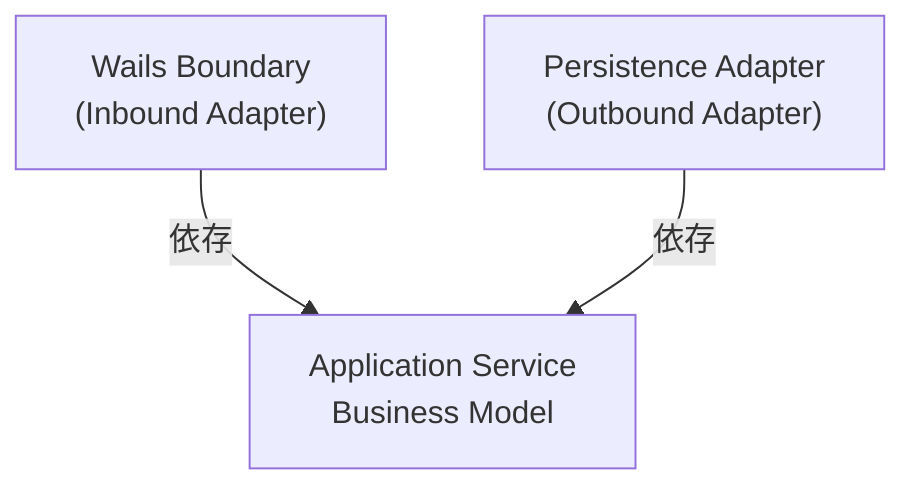
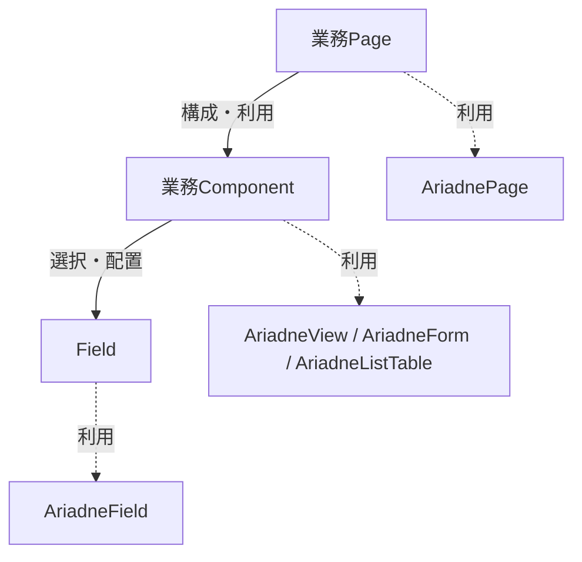

# Project ARIADNE — Prototype Phase 5：Windows Application (v2 Draft)

> **Status: DRAFT**  
> 本文書はPhase 5正本再構成（Issue #22）の作業用ドラフトである。A02〜A06で段階的に整備し、A07で正式切替が承認されるまで、現行正本 `phase-5-windows-application.md` を置き換えない。

## 1. Purpose & Scope

### 1.1 Purpose

Prototype Phase 5では、Svelte / Wails v3 / GoによるWindows Applicationを実装し、PROJECT ARIADNEのWindows Applicationとしての技術的成立性を検証する。

Task管理Applicationを題材に、Frontend、Wails Boundary、Application Service、File Persistenceを連携させ、Taskの参照・作成・編集・永続化・復元までを実際に動作させる。

本Phaseの目的は、Applicationが動作することの確認だけではない。採用したApplication Architectureについて、責務分離と境界が設計どおりに実装可能であることに加え、**その設計判断自体が妥当であるか**を実装・検証を通じて確かめる。

### 1.2 Design Principles

Phase 5では、以下の4原則に基づいて設計・開発する。

1. **理解と納得に基づく設計**  
   採用する設計の理由と選択肢を理解し、納得したうえで決定する。テルとアリアドネは、提案・疑問・反論を交わしながら設計判断を深める。既存の実装が動くことだけを理由に判断を固定しない。
2. **全体の整合性を守る**  
   個々の機能や局所的な実装の都合だけでなく、Architecture全体の責務境界、採用済み設計判断、関連文書との整合性を重視する。
3. **小さく成立させ、検証を通じて育てる**  
   完成形を一度に作り込まず、小さな単位で設計・実装・Test・Build・実機確認を繰り返す。未知の技術要素は段階的に検証し、その結果を次の判断に反映する。
4. **美しく、無理のない構造を選ぶ**  
   不必要な複雑さや先回りした抽象化を避け、責務が明確で、自然に成立する構造を選ぶ。実装コストだけでなく、構造のわかりやすさと将来の変更容易性を考慮する。

具体的な開発サイクル、Test・Buildの運用、設計判断の記録方法および協働の進め方は、第2章 Development Processで扱う。

### 1.3 Scope

Prototype Phase 5では、Task管理を題材として、以下を対象とする。

- Taskの一覧・詳細参照、新規作成、編集
- ローカルYAMLへのTask保存、およびApplication再起動後の復元
- TaskのValidationと、正常系・異常系のApplication内での伝達・処理
- Windows ApplicationとしてのUI、Build、Test、実機での起動・操作確認
- Frontend / Wails Boundary / Application Service / File Persistenceの連携、責務分離およびArchitecture設計判断の検証

Taskの**新規作成**は対象に含む。一方、Task管理環境の**初回初期化**（`tasks.yaml` が存在しない場合の初期化を含む）は対象外とし、Coreで扱う。Taskが0件であること自体は正常な状態として扱う。

Phase 2〜4で扱ったElements / API / DDLのモデルおよび変換構造を、Applicationから操作する機能は本Phaseの対象外とする。それらを扱うApplication機能やValidator / Resolver / Generator等の実装はCoreで扱う。

### 1.4 Completion Criteria

Phase 5の完了は、以下の観点で判断する。

1. **Applicationの成立**：Task管理の対象操作とYAML永続化・復元が、Windows Applicationとして動作する。
2. **Architectureの成立**：採用した責務分離と境界に基づいてApplicationを構成でき、その設計判断の妥当性を検証できている。
3. **検証の成立**：必要な自動Test、BuildおよびWindows実機での動作確認が成立している。
4. **判断の整理**：検証を通じて確定した重要な設計判断、残課題およびCoreへの引継ぎ事項が整理されている。

個別BehaviorやTestの詳細な合否条件は、第2〜4章および関連するBehavior Map・Test文書で定義する。

## 2. Development Process

### 2.1 Development Approach

PROJECT ARIADNEのPrototype Phase 5では、小さな単位で設計・実装・検証を繰り返す反復型の開発プロセスを採用する。

開発はPlanning、Design、Implementation & Test、Build & Verificationを基本的な活動として構成し、TDDを実装の基本手法とする。

各活動は一方向に完了するものではない。Testや実機確認によって設計上の問題、仕様の不足、計画の不整合が明らかになった場合は、必要な段階へ戻って見直す。

重要なのは、当初の計画を守り切ることではなく、実装と検証を通じて設計判断の妥当性を確かめ、Application全体を無理のない構造として成立させることである。

### 2.2 Planning Process

Phaseの目的とScopeを明確にしたうえで、実現する主要なBehaviorをBehavior Mapとして整理する。

Behaviorは原則として1つのユーザーActionを基本単位とし、同じActionに対する結果の分岐はResult Patternとして整理する。各Behaviorについて、開始状態、Action、結果、Frontend / Backendの関与を明らかにする。

Behavior Mapは、Test対象を整理するためだけの文書ではない。Phase全体で実現する振る舞いを俯瞰し、Stepの分割と実施順序を検討するための入力情報とする。

Stepは、機能間の依存関係と段階的な検証の成立順序を考慮して分割する。各Stepでは、必要な課題検討、設計、実装、検証を小さな単位で進められることを重視する。

後続Step固有の詳細仕様を先行して決定しなければ現在のStepが成立しない場合は、安易に先回りするのではなく、Behavior MapやStepの分割・順序が適切かを再検討する。

ただし、現在のStepで設計する共通機構について、既知の後続Behaviorとの整合性を考慮することは妨げない。

Behavior MapとStep計画は固定的なものではない。開発中に新たなBehaviorや依存関係が明らかになった場合は、必要に応じて更新する。

### 2.3 Design Process

各Stepでは、実装に先立って課題検討と設計を行う。

まず、実現したいこと、前提条件、制約、既存の設計判断、未決定事項を整理する。そのうえで、責務境界と必要な構造を検討し、実現方法を具体化する。

設計では、最初に挙がった案や既存実装を無条件に採用しない。必要に応じて代替案を比較し、それぞれの成立条件、複雑さ、トレードオフを明らかにする。

設計判断は、その理由を理解し、納得したうえで確定する。重要な判断は、第3章Application Architecture、第4章Application Specificationなど、該当する正本へ反映する。

Testや実装を通じて設計の不足・矛盾が明らかになった場合は、設計へ戻る。問題がBehaviorの定義やStepの分割・実施順序に及ぶ場合は、Planning Processまで戻って見直す。

Testを通すためだけに、不自然な構造や例外的な処理を積み重ねない。

### 2.4 Implementation & Test Process

#### Test Strategy

PROJECT ARIADNEでは、Testを技術要素ではなく、保証する範囲によって分類する。

基本戦略は、Frontend Module Test（FMT）とBackend Module Test（BMT）によってBehaviorを保証することである。

**Frontend Module Test（FMT）**

対象BehaviorのFrontend側の振る舞いを、公開されたSvelte Componentの適切な境界から確認する。

Backendを利用する場合はWailsが生成するBindingをMockし、ユーザー操作に対する表示、状態変化、Validation Message、Toastなどを確認する。

子Component単位で網羅的にTestすることは目的とせず、1 Behavior = 1 Component = 1 Test Fileとも規定しない。

VitestとSvelte Testing Libraryを使用する。Test Codeは実装と分離したTest用Directoryに配置し、Behavior単位で整理する。

**Backend Module Test（BMT）**

対象BehaviorのBackend側の振る舞いを、Wails Boundaryを介さず、Application Serviceの公開Operationを直接呼び出して確認する。

Test Codeは実装とは分離したTest用Packageに配置し、Behavior単位で整理する。1 Behavior = 1 Test Fileとは規定せず、Result PatternやTest Caseに応じて複数ファイルへ分割してよい。

File I/Oを伴う場合も、原則としてFile SystemをMockせず、`t.TempDir()`などで用意した一時Directory上で実際のFile AdapterとFile I/Oを使用する。

Application ErrorはServiceの公開APIを通じて分類とError Chainを確認する。Wails PublicErrorへの変換はBMTの対象外とする。

**Logic / Development Step Test**

FMT/BMTのModule TestだけではTest Patternが過大になる複雑なLogicや、未知の技術要素を段階的に検証する場合に限り、補助的に使用する。

Development Stepとして作成したTestは、上位のModule Testが成立した後、継続して保証する価値がなければ削除してよい。

Logic / Development Step Testは通常の`test.sh`およびBuild Gateには含めない。必要な場合は`backend-test.sh --logic`で実行する。

#### Behavior Test Specification

Behavior Mapで定義したBehaviorについて、各Stepの課題検討・実装設計を終えた後、実装直前にBehavior Test Specificationを具体化する。

Behavior Test Specificationでは、Result Patternごとに必要なFrontend / Backend Testを検討し、Dependency、Given、When、Expectedを明らかにする。

Behavior Mapは振る舞いの正本、Behavior Test Specificationはその保証方法を定義する文書とする。

1つのResult Patternを複数のTest Caseで確認してよい。特にBackendでは、Application上同じ結果になる複数の失敗原因を、必要に応じて個別に検証する。

TestのGivenを構築するために先行Behaviorの機能を利用する場合は、依存先をBehavior Test Specificationに明記する。先行Behaviorの保証内容を重複してTestすることは目的とせず、依存先のTestがGREENであることを前提とする。

Behavior Test Specificationは、Test Codeの内部実装を詳細設計するための文書ではない。

#### TDD Implementation Cycle

Behavior Test Specificationに基づき、実装より先にModule Testを作成する。

Module Testは対象Behaviorの完成条件を示すものであり、GREENにするための最短経路で実装することは目的としない。

基本サイクルは次のとおりとする。

1. 対象BehaviorとResult Patternを選択する。
2. 必要なModule Testを作成し、REDとなることを確認する。
3. 既存のModule TestのGREENを維持しながら、小さな技術的・機能的単位で実装を進める。
4. 必要に応じてLogic / Development Step Testを利用し、段階ごとに動作を確認する。
5. 新たに作成したModule Testを含め、すべてのModule TestがGREENとなることを確認する。
6. 必要に応じてRefactorし、再びALL GREENを確認する。

新たなModule TestがREDである間も、既存のModule TestはGREENを維持することを原則とする。

実装中に設計上の疑問が生じた場合は、必要な設計判断へ戻る。問題がStep計画に及ぶ場合はPlanning Processまで戻る。

### 2.5 Build & Verification Process

Implementation & Test Processで成立した実装を、Windows ApplicationとしてBuildし、実機で確認する。

日常的なModule Testの統一入口は`test.sh`とする。

`test.sh`は`backend-test.sh`と`frontend-test.sh`を実行し、両方がPASSした場合のみPASSとする。Logic / Development Step Testは通常実行に含めない。

Frontend / Backendの各Test Scriptは、日常的に確認しやすいコンパクトな結果表示とする。TestごとのPASS / FAIL、Total、Error Rate、実行時間を基本とし、Errorの詳細はFailure時に表示する。冗長なDOMやStack Traceなどのノイズを抑制する。

`build.sh`は、既存のBuild成果物を削除した後、`test.sh`をBuild Gateとして実行する。

Module TestがすべてPASSした場合のみWails ApplicationをBuildする。FAILした場合はBuildせず、以前の成果物も残さない。

Build後は、Windows実機でApplicationを起動し、操作、画面表示、状態遷移、FrontendからBackendおよびFile Persistenceまでの連携を確認する。

CSS、Layout、Color、Spacing、SizeなどのVisual Designは、原則として自動Module Testの保証対象とせず、実機で確認する。

一方、表示の有無、Validation Message、Toast、画面状態の変化など、Behaviorとして意味を持つUI状態はFMTの対象とする。

Buildと実機確認はModule Testの代替ではない。異なる保証範囲を持つ検証として組み合わせる。

### 2.6 Communication & Collaboration

PROJECT ARIADNEでは、テルとアリアドネが対話を通じて設計・開発を進める。

テルは、実現したいこと、目的、譲れない条件を提示し、設計判断を確定する主体となる。

アリアドネは、目的や課題の構造化、実現方法の提案、代替案の比較、疑問・矛盾の指摘、反論、記録の整理を担う。

両者は単に提案と承認を繰り返すのではなく、設計判断の理由を共有し、理解と納得に至るまで議論する。

アリアドネはテルの提案を無条件に肯定しない。既存実装や過去の決定についても、必要であれば疑問を呈する。

一方、テルが設計上の疑問を持っている段階で、アリアドネが先行して実装を進めない。

設計判断が確定したら、小さな単位で実装・検証を進め、結果を共有する。問題が見つかった場合は、原因と影響範囲を確認し、必要な段階へ戻って協議する。

### 2.7 Development Artifacts & Management

PROJECT ARIADNEでは、設計判断を保持するDocument、BehaviorとTestの関連文書、作業管理情報、Source Codeについて、それぞれの役割と更新方法を区別する。

設計判断の継続的な参照先は正本とし、IssueやPull Requestを正本の代替としない。

| 対象 | 役割 | 更新方式 | 管理方針 |
| --- | --- | --- | --- |
| Phase正本 | 目的、設計原則、Architecture、Application Specificationなどの重要な設計判断を保持する | PR運用（アリアドネ） | 設計判断の確定・変更時に更新する |
| Behavior Map | Phase全体のBehaviorを整理し、Step計画の入力とする | PR運用（アリアドネ） | Phase開始時に作成し、Behaviorや計画の変更に応じて更新する |
| Behavior Test Specification | BehaviorごとのTest対象、条件、期待結果を定義する | PR運用（アリアドネ） | 各Behaviorの実装直前に具体化し、変更に応じて更新する |
| Validation Rules | FieldおよびCorrelation Validationの判定条件を定義する | PR運用（アリアドネ） | 独立Documentとして維持するか第4章へ統合するかは、第4章の再編集時に判断する |
| GitHub Issue | Activity、Task、未決定事項、進捗、検討結果を管理する | 直接更新（アリアドネ） | 作業や検討の進行に合わせて更新する |
| Source Code | Applicationの実装を保持する | PR運用（テル） | テルが自ら実装し、変更を管理する |

DocumentationのPR運用では、アリアドネがBranch上で編集・Commitし、Pull Requestを作成する。テルがレビューし、合意後にMergeする。

Source Codeの実装・変更・Mergeはテルが行う。

各Stepの完了時には、実装・検証結果、確定した設計判断、残課題を整理し、必要なDocumentとIssueを更新する。


## 3. Application Architecture

### 3.1 Architecture Overview

PROJECT ARIADNEでは、**Go Service First**を基本方針とし、Application Serviceを中心としたArchitectureを採用する。

**Frontend、Wails Boundary、Backendの3つをApplicationの基本構造とし、BackendにApplication Serviceが含まれる。**

Frontendは画面表示・入力および画面状態を扱い、Wails Boundaryを通じてBackendの機能を利用する。BackendはApplication Serviceを中心に業務処理と永続化を担う。

各構成要素の内部構造と責務は、後続の節で定義する。

#### Architecture Principles

##### Go Service First

Application Serviceは、Wailsに依存しない通常のGo Serviceとして実装する。

WailsはFrontendとBackendを接続するために利用し、業務処理をWails固有の実装へ持ち込まない。

##### Model Separation

Application内部では、責務に応じてモデルと状態の表現を分離する。

Backendでは、以下の3種類のモデルを区別する。

- **Business Model**：業務上の概念と成立条件を表す。
- **Public Model**：Application Serviceが提供するOperationの入出力契約を表す。
- **Persistence Model**：永続化方式に適したデータ表現を表す。

Public ModelはBusiness Modelの完全な写像ではなく、Operationの目的に応じて必要な入出力を表す。取得用のPublic Modelと登録・更新用の入力モデルは独立して定義し、取得用モデルをそのまま入力モデルとして流用しない。

Frontendでは、Public Modelをそのまま画面の状態として扱うとは限らない。必要に応じてPublic Modelの表現を変換し、画面の表示・入力・操作に必要な情報や状態を管理する。

各モデルの変換責務はBackend Architectureで、Frontend内部の状態管理と公開IFへの適合はFrontend Architectureで定義する。

##### File-based Persistence

PROJECT ARIADNEは、ファイルによる永続化を基本方針とする。Databaseへの置き換えを前提とした永続化方式の抽象化は行わない。

Persistence Portは、Business Model単位の取得・格納を契約とし、登録と更新には共通の`Store` Operationを使用する。

`Store`は`StoreIntent`によって新規登録（Deposit）と既存データの置き換え（Replace）を区別する。部分UpdateをPersistence Portの基本操作とはしない。

Application Serviceは、ファイルの具体的な形式・構造・読み書き手順を認識せず、Persistence Adapterがそれらを担当する。

Application Serviceが定義するPersistence PortをPersistence Adapterが実装する。

Package間の依存方向およびPort / Adapterの詳細はBackend Architectureで定義する。

##### Wails Boundary

FrontendとApplication Serviceの接続にはWails v3を使用する。

Wails Boundaryは、FrontendとApplication Serviceの接続およびデータの受け渡しを担う。境界を越えて受け渡すデータにはPublic Modelを使用し、Business Modelを直接公開しない。

Wailsが生成するBindingはFramework管理のコードとして扱い、手動編集しない。

Application Serviceとの接続、Bindingおよび境界でのエラー変換はWails Boundaryで定義する。

##### Source of Truth

Applicationが管理するデータのSource of Truthは、Persistence Adapterを通じて永続化されたデータとする。

Frontend StateやApplication Service内のBusiness Modelは、永続化データの正本とはしない。

具体的な永続化方式、データ構造および読み書きの仕様はApplication Specificationで定義する。

### 3.2 Backend Architecture

#### 3.2.1 Backend Structure

Backendでは、**Business Modelを中心にApplicationを構成する。**

Business Modelは業務上の概念と成立条件を表し、**登録・更新・復元のいずれにおいても、成立した時点ですべての成立条件を満たすことを保証する。** 成立条件を満たす前の入力情報や中間状態はBusiness Modelとして扱わず、不正な状態のBusiness Modelを生成・変更・復元させない。

Business Modelの成立条件違反は、モデルとして成立しないことを表す。これをApplication上のどのErrorとして扱うかは、そのBusiness Modelを生成・変更・復元しようとした呼び出し元の文脈に応じて決定する。

Application Serviceが業務処理を担い、Persistence AdapterがBusiness Modelの保存・復元を担う。

Wails BoundaryとPersistence Adapterは、いずれもApplication Service側に依存するAdapterとして位置づける。



図の矢印は、処理やデータの流れではなく、**ソースコード上の依存方向**を示す。Wails BoundaryはApplication ServiceのOperationを呼び出し、Persistence AdapterはApplication Service側で定義されたPersistence Portを実装する。

Persistence Portは、Application Serviceが永続化に対して要求できる操作を定義するInterfaceであり、Application Serviceと同じPackageに配置する。これにより、Application ServiceはPersistence Adapterの具体的な実装に依存しない。

Persistence Portは、Application Serviceが必要とする操作を契約として定義する。操作の命名と粒度は、永続化技術の機能ではなく、Application Serviceが表現したい操作意図に基づいて決定する。

#### 3.2.2 Application Service

Application Serviceは、Business Modelを中心に、Applicationが提供する業務処理を実現する。

Business Modelが保証する成立条件を前提として、Operationに必要な処理を組み立てる。

主な責務は以下とする。

- Business Modelを用いた業務処理の実行
- Public ModelによるOperationの入出力契約の定義
- Business ModelとPublic Modelの相互変換
- Persistence Portを介したBusiness Modelの取得・保存要求

Application Serviceは、Frontendの画面表示や具体的な永続化方式を認識しない。

#### 3.2.3 Persistence Adapter

Persistence Adapterは、Business Modelの保存・復元を実現する。

永続化方式に応じたPersistence Modelを定義し、Business Modelとの相互変換を担当する。

Application Serviceが操作の意図を決定し、Persistence AdapterはPersistence Portで定義された契約に従って実行する。

Persistence Adapterは、具体的な保存形式や入出力処理を担当する。

#### 3.2.4 Model Separation

Backendでは、**Business Modelを中心とし、目的に応じてPublic ModelとPersistence Modelを定義する。**

Public Modelは、Application Serviceが提供するOperationの入出力契約を表す。取得系ではBusiness Modelの必要な側面を公開し、登録・更新系ではBusiness Modelを成立・変更させるための要求を表す。Business ModelとPublic Modelは一対一に対応する必要はない。

Persistence Modelは、Business Modelを永続化方式に適合させた表現であり、保存・復元に使用する。

Persistence Modelには、`createdAt`・`updatedAt`のような記録管理用Timestampを持たせることができる。これらはBusiness Modelの成立条件を表すものではなく、Business Modelには含めない。記録管理用TimestampはPersistence Adapterが生成・維持し、画面表示には使用しない。業務上必要な日時情報は、Business Modelに別途定義する。

Business ModelとPublic Modelは、それぞれ独立したPackageで定義する。

モデル間の変換責務は以下とする。

| 変換 | 担当 |
| --- | --- |
| Business Model ↔ Public Model | Application Service |
| Business Model ↔ Persistence Model | Persistence Adapter |

Application ServiceはPersistence Modelを認識せず、Persistence AdapterはPublic Modelを認識しない。


### 3.3 Frontend Architecture

#### 3.3.1 Frontend Structure

Frontendの画面は、**業務Page、業務Component、Fieldの3階層**で構成する。

各階層は、必要な下位要素を構成し、Ariadne系の共通Componentを利用して共通の表示構造や振る舞いを備える。Ariadne系Componentは独立した階層ではない。



図の実線は画面構成上の3階層の関係、破線は各階層が共通Componentを利用する関係を示す。処理の実行順序やデータ変換経路、厳密なSvelte Componentの包含関係を示すものではない。

##### Field

Fieldは、個々の値の表示・入力を担当する。Text、Textareaなどの汎用Fieldに加え、業務固有の意味や表示方法を持つFieldを定義できる。

Fieldは`AriadneField`を利用し、Label、Value、Errorの共通構造と装飾を備える。個々のFieldは値の種類に応じた表示・入力方法を担当する。

Fieldの表示形態は`reference`（参照表示）、`edit`（入力・変更）、`cell`（一覧表のセル表示）を区別する。各Fieldは用途に応じて必要な表示形態を実装し、3形態すべてを一律に要求しない。

##### 業務Component

業務Componentは、必要なFieldを選択し、値を割り当て、組み合わせと配置を決定する。

業務Componentは、用途に応じて`AriadneView`、`AriadneForm`、`AriadneListTable`などを利用し、共通の表示・入力構造と振る舞いを備える。業務Component自身が、Field群の構成と利用する共通Componentの両方を決定する。

- `AriadneView`：参照表示の共通構造とスクロール
- `AriadneForm`：入力領域の共通構造、スクロール、Submit受付、操作ボタンの配置
- `AriadneListTable`：一覧表示の共通構造、行・列の表示、スクロール

##### 業務Page

業務Pageは、画面全体を構成し、必要な業務Componentを利用する。

業務Pageは`AriadnePage`を利用し、HeaderとContentsの共通構造を備える。`AriadnePage`はContents自体のスクロールを管理せず、必要なスクロールは内部のComponentが担当する。

業務PageはStore / Contextと業務Componentを結びつけるが、Backendを直接呼び出さない。データ変換、入力値の再構成、登録・更新における要求内容の構築は3.3.2で定義する。

##### Modal / Toast

Confirmation ModalとNotification Toastは、画面構成の3階層とは別に、複数の画面から利用する共通Componentとする。

- **Confirmation Modal**：意思確認を行い、判断結果を呼び出し元へ返す。業務処理の実行やNavigationの確定は担当しない。
- **Notification Toast**：指定された通知内容を表示する。通知内容の決定や業務処理の結果判定は担当しない。

Form利用時の意思確認と正常な登録・更新結果の通知は3.3.2、未保存変更がある場合の離脱確認は3.3.3、Error通知とLoggingの関係は3.5で定義する。

#### 3.3.2 Frontend Data Management

Frontendでは、データの取得・保持、業務データの分解・統合、個々の値の表現、画面における業務操作を、それぞれの責務に応じて分担する。

##### Responsibility

| 要素 | 責務 |
| --- | --- |
| **Feature Management** | Feature内の画面遷移を制御する |
| **Context** | 遷移準備中の状態を含め、画面に対応するStoreを管理する |
| **Store** | Backendからデータを取得・保持し、必要に応じて技術的な表現差異を補正する |
| **業務Page** | 画面表示を構成し、画面における業務操作とBackendへの要求内容の構築を担当する |
| **業務Component** | 業務データの分解・統合とFieldの配置を担当する |
| **Field** | 個々の値の入力・表示と表現変換を担当する |

##### Data Management

Application全体で共有するStateはApplication側で管理し、特定のFeatureに属するStateは、そのFeatureの有効期間内で管理する。

Feature内のデータ管理では、Contextが画面に対応するStoreを管理する。画面遷移の準備中に必要なStoreもContextが管理し、画面遷移の制御はFeature Managementが担当する。

StoreはBackendから取得したPublic Modelを保持する。業務画面固有の加工は行わず、Wails Binding等による技術的な表現差異がある場合のみ必要な補正を行う。

Storeは、Application Serviceの正常応答として想定しない`null`を受け取った場合、Errorとして扱う。

業務PageはContextを介してStoreのデータを取得し、業務Componentへ渡す。

業務Componentは業務データを個々のFieldへ分解し、Fieldから受け取った値を統合する。Fieldの選択・配置も担当する。

Fieldは個々の値の表示・入力と表現変換を担当する。業務データ全体の構造は認識しない。

入力値の変更有無はFieldが自身の保持する状態から判定し、上位Componentはその判定結果を利用する。上位Componentで変更有無を重複して判定しない。

業務Componentによる統合はFieldの値をまとめるところまでとし、Backendへ渡すPublic Modelの構築は業務Pageが担当する。

##### Validation

Frontend Validationは、個々のFieldを対象とするSingle Field Validationと、複数Fieldの関係を対象とするCorrelation Validationに分ける。

Frontend Validationは入力時の利用者支援を目的とし、Business Modelの成立条件を保証するものではない。Business Modelの成立条件はBackendで保証する。

Field単位のValidationと複数FieldにまたがるValidationは、責務を分離して管理する。

具体的な判定条件や実行タイミングはApplication Specificationで定義する。

##### Operation Control

業務Pageは、登録・更新など画面における業務操作を制御する。

業務操作に必要な入力データを業務Componentから受け取り、Backendへの要求を構成する。

登録・更新におけるBackend呼び出しは、Storeによるデータ取得とは別の責務として扱う。具体的な呼び出し方式と担当要素は、実装時に決定する。

利用者の確認が必要な場合はConfirmation Modalを利用する。Confirmation Modalは判断結果を返すのみで、業務処理を実行しない。

業務Pageは登録・更新の成功時にNotificationを要求する。Notification Toastは指定された内容を表示するのみで、業務処理の結果判定は担当しない。この成功通知は未実装とする。

#### 3.3.3 Navigation Management

FrontendのNavigationは、Application全体のFeatureを切り替えるPrimary Navigationと、Feature内の画面を切り替えるFeature Navigationに分ける。

##### Primary Navigation

Primary Navigationは、Application全体のFeature切替を担当する。

Featureを切り替える際は、切替前のFeature ComponentとそのStateを破棄する。再度同じFeatureを選択した場合は、新しいStateで開始する。

Prototypeでは、TaskとConfigを切替対象とする。

##### Feature Navigation

Feature内の画面遷移はFeature Managementが制御する。

Feature ManagementはNavigation Requestを受け付け、Contextを介して遷移先の準備と確定を行う。

画面遷移は、**Prepare / Commitの二段階**で扱う。

| 段階 | 責務 |
| --- | --- |
| **Prepare** | 遷移先画面に必要なデータを取得・準備する。現在の確定済みStateは変更しない |
| **Commit** | Prepare成功後に遷移先を確定し、Navigation Stateと表示画面を切り替える |

Prepareに失敗した場合はCommitせず、現在のNavigation Stateと表示画面を維持し、Error Handlingへ委ねる。

Navigation Stateの確定と表示画面の切替は一貫して行い、選択状態と表示内容の不整合を防ぐ。

遷移処理中は、重複するNavigation Requestを受け付けない。

##### Navigation Data Refresh

画面遷移に必要なデータは、Prepareの段階でBackendから取得する。

Prototypeでは、Task ListからTask Referenceへ遷移する際、一覧で保持しているTaskSummaryを流用せず、指定されたIDによりTask詳細を取得する。

##### Unsaved Changes

未保存の変更がある画面から離脱する場合は、Confirmation Modalを利用して利用者の判断を確認する。

Confirmation Modalは判断結果を返すのみとし、画面遷移の制御はFeature Managementが担当する。

### 3.4 Wails Boundary

Wails Boundaryは、FrontendとApplication Serviceを接続する境界である。

Application ServiceはWailsに依存せず、Wails BoundaryがFrontendとの接続とErrorの公開用変換を担当する。

#### 3.4.1 Application Service Connection

Wails Boundaryは、Application ServiceのOperationのうち、Frontendから利用するものだけを接続する。

Application Serviceへの処理委譲と、返却されたErrorのPublicErrorへの変換を担当する。

Business LogicやValidationは実装しない。

#### 3.4.2 Public Model / Binding

FrontendとApplication Serviceの間で受け渡すデータにはPublic Modelを使用する。

Wailsが生成するTypeScript BindingおよびModelはFramework管理のコードとして扱い、手動編集しない。


### 3.5 Error Handling / Logging

Applicationでは、Errorの原因情報を保持しながら、内部の診断情報とユーザーへ公開する情報を分離する。

Error HandlingはBackend、Wails Boundary、Frontendの責務に分け、LoggingはApplication全体の共通方針として定義する。

#### 3.5.1 Backend Error Handling

BackendではGoのError Chainを使用し、下位Layerで発生したErrorを必要に応じてWrapして上位Layerへ伝達する。

各Layerは、自身の責務に基づいてErrorを意味付けする。

- **Persistence Adapter**は、永続化技術に固有の失敗をPersistence Portの契約に沿ったErrorへ変換する。
- **Application Service**は、Operationの成立可否を判断し、必要に応じてApplicationとして意味のあるErrorへ変換する。

Errorの変換時には原因情報を保持し、Application ServiceがPersistence Adapterの実装詳細に依存しないようにする。

Errorの分類は、Applicationの振る舞いに必要な意味を基準とし、不要な詳細分類を上位Layerへ公開しない。

具体的なError分類およびOperationごとの発生条件は第4章で定義する。

#### 3.5.2 Wails Boundary Error Handling

Wails Boundaryは、Application Serviceから伝達されたErrorを、Frontendへ公開可能な形式に変換する。

Backend内部のError Chainをそのまま公開せず、公開用Messageを持つ`PublicError`へ変換する。

`PublicError`は以下の情報を持つ。

- `Processed`：公開用に処理済みであることを示す。
- `Message`：Frontendへ公開するMessage。

Application Error Codeは設けない。

Wails Runtimeを通じて伝達された`PublicError`は、FrontendではJavaScriptの`Error.cause`から参照する。

Prototypeでは、Backendのpanicに対する捕捉・回復処理を実装しない。想定外の形式で伝達されたErrorは、Frontend側のFallbackで扱う。

#### 3.5.3 Frontend Error Handling

Frontendでは、Frontend自身で発生したErrorと、Backendから伝達されたErrorを共通の仕組みで扱う。

公開用に処理済みのErrorは、以下の形式で識別する。

- `ProcessedError`：Frontend側で公開用に処理したError。
- `Error.cause.Processed == true`：Wails Boundaryで公開用に処理したError。

共通の`toErrorMessage`は、処理済みErrorから公開用Messageを取得する。

公開用に処理済みであることを確認できないErrorは、未処理Errorとして扱う。この場合、内部情報をそのまま公開せず、共通の予期しないError Messageを使用する。

未処理Errorへの対応は、通常のError Handling経路ではなく、想定外のErrorや伝達形式の不整合に備える防御的なFallbackとして位置付ける。

業務操作で発生したErrorは業務Pageが、画面遷移のPrepareで発生したErrorはFeature Managementが、それぞれError Handlingへつなぐ。エラー通知用の公開Messageは`toErrorMessage`によって取得し、Notification Toastへ渡してユーザーへ通知する。Notification Toast自身はErrorの判定やMessageの決定を行わない。

Toastの具体的な表示・操作仕様は第4章で定義する。

#### 3.5.4 Logging

Loggingは、診断に必要な情報を保持しながら、同じErrorに対する重複記録を避けることを基本とする。

**Backend Logging**

Backendでは、Errorを各Layerで重複して記録せず、Error Chainとして上位へ伝達する。

原則としてWails Boundaryで診断情報を記録し、Frontendへ公開するMessageとは分離する。

Information / Debugについては、その情報を認識しているLayerで記録する。

**Frontend Logging**

Frontendでは、公開用に処理済みであることを確認できないErrorを検出した箇所で診断情報を記録する。

処理済みErrorについては、原則として重複して記録しない。

**Prototype Scope**

Prototypeでは、Errorの原因情報を失わない構造を優先し、本格的なApplication Loggingは必須実装としない。

具体的なLogger、出力先、Log Format、Log Rotation等はCoreで検討する。

## 4. Application Specification

本章では、PROJECT ARIADNEのApplication共通仕様と、Prototypeで題材とするTask管理の具体的な仕様を扱う。共通仕様はPROJECT ARIADNEのベースとなる振る舞いを定義し、必要に応じてPrototypeでの適用を示す。Task固有の仕様は4.4および4.5で定義する。

### 4.1 Common UI Specification

#### 4.1.1 Application Shell / Navigation

##### Application Shell

PROJECT ARIADNEのApplicationは、Header、Footer、Primary Navigation、および選択された機能の表示領域から構成する。

- **Header**：Applicationを識別する情報を表示する。
- **Footer**：Applicationに関する補助情報を表示する。
- **Primary Navigation**：Applicationが提供する機能を切り替える。
- **Feature Area**：選択された機能の画面を表示する。

各機能は、必要に応じてSide NavigationとMain Areaを持つ。

Prototypeでは、Headerに`PROJECT ARIADNE`を表示し、Primary NavigationにTaskとConfigを配置する。

Task機能ではSide NavigationとMain Areaを使用する。Configは画面切替を確認するためのDummy Pageとし、設定機能自体は実装しない。

##### Navigation

Navigationは、Application全体の機能を切り替えるPrimary Navigationと、各機能内の画面を切り替えるFeature Navigationに分ける。

Feature Navigationの表示には、必要に応じてSide Navigationを使用する。

Primary Navigationによって機能を切り替えた場合は、選択された機能の画面を表示し、切替前の機能に属する画面とStateを破棄する。

画面遷移では、ユーザーによるNavigation操作と、実際の遷移成立を区別する。

遷移先で必要なデータがある場合は、遷移確定前に取得・準備する。準備に成功した場合のみ、Navigationの選択状態と表示画面を切り替える。

準備に失敗した場合は遷移を確定せず、現在のNavigation選択状態と表示画面を維持し、Error Toastを表示する。

PrototypeのTask管理では、Feature NavigationにSide Navigationを使用する。Task固有の画面構成、データ取得および遷移条件は、4.5 Task Functional Specificationで定義する。

#### 4.1.2 Common Layout Components

PROJECT ARIADNEでは、Pageの構造、業務固有の表示・入力内容、および共通的な表示・操作の振る舞いを分離する。

業務Page・業務Component・Fieldの構成と、各Ariadne系共通Componentの利用関係は、3.3.1 Frontend Structureで定義する。本節では、共通Layout Componentの具体的な表示・操作仕様を定義する。

##### AriadnePage

`AriadnePage`は、4.1.1で定義したFeature Area内に表示される業務Pageの共通構造を提供する。

Page HeaderとContentsの表示領域を持つ。Page HeaderはApplication全体のHeaderとは別の領域とする。

Contents自体はスクロールを管理せず、必要なスクロールは内部に配置されたComponentが担当する。

##### AriadneView

`AriadneView`は、参照表示のための共通コンテナを提供する。

配置されたコンテンツが表示領域に収まらない場合は、コンテナ内部でスクロールする。

表示するFieldの種類・配置・寸法は、利用側の業務Componentが決定する。

##### AriadneForm

`AriadneForm`は、入力領域の共通構造、内部スクロール、操作ボタンの配置、Submit受付、およびConfirmation Modalによる意思確認を提供する。

操作ボタンはFormに割り当てられた表示領域の右下に固定し、入力内容との重なりを許容する。

Submit時には利用側の業務ComponentへValidationを要求する。Validationが成功した場合のみConfirmation Modalを表示し、Confirm / Cancelの判断を受け付ける。

Confirmされた場合は、利用側へ業務処理の実行を通知する。

Confirmation ModalでCancelされた場合は、Modalを閉じてSubmitを中止する。業務処理の実行や画面遷移は要求しない。

業務固有の入力項目、Validation Ruleおよび業務処理そのものは定義しない。

Validationの具体的な動作は4.2 Validation Specificationで、Confirmation Modalの表示仕様は4.1.4で定義する。

##### AriadneListTable

`AriadneListTable`は、一覧表の表示領域、表示件数、および内部スクロールを提供する。

一覧表の行・列の構成および表示するデータは、利用側の業務Componentが決定する。

##### Layout / Scrolling

業務Componentは、親から割り当てられた領域を利用してコンテンツを構成する。

コンテンツの寸法は基本的に固定とし、Windowの縮小に合わせて自動的に縮小しない。

スクロールが必要な場合は、該当する表示領域を管理するComponentが自身の内部でスクロールを提供する。

Prototypeでは、Task一覧に`AriadneListTable`、Task詳細参照に`AriadneView`、Task作成に`AriadneForm`を利用する。

#### 4.1.3 Common Field / Input Components

PROJECT ARIADNEでは、Fieldの共通表示構造と、値の種類に応じた表示・入力方法を分離する。

Fieldの構成、責務およびVariantの定義は3.3.1 Frontend Structureに従う。本節では、Fieldの共通的な表示・入力仕様を定義する。

##### AriadneField

`AriadneField`は、Label、Value、Errorの表示領域と共通の装飾を提供する。

値の型や業務上の意味は扱わず、各Field Componentが値に応じた表示・入力方法を提供する。

Fieldの幅と配置は利用側の業務Componentが決定し、Fieldは割り当てられた領域内で表示と必要な高さを管理する。

##### Common Field / Variant

共通Fieldは以下の3種類とし、用途に応じてVariantを使い分ける。

| Field | reference | edit | cell |
|---|:---:|:---:|:---:|
| TextField | ○ | ○ | ○ |
| SubTextField | ○ | — | ○ |
| TextareaField | ○ | ○ | — |

各Variantの表示・入力仕様は以下とする。

**TextField**

- `reference`：指定された行数に応じた固定の高さで表示する。省略表示は例外的な処置とし、Tooltipによる補完は行わない。
- `edit`：単一行Textの入力を提供する。
- `cell`：一覧表のCell内に表示する。必要に応じて省略表示とTooltipによる補完を行う。

**SubTextField**

- `reference`：補助的なTextを表示する。省略時もTooltipによる補完は基本的に行わない。
- `cell`：一覧表等で補助的なTextを表示する。省略時もTooltipによる補完は基本的に行わない。

**TextareaField**

- `reference`：固定の高さで表示し、内容が収まらない場合は内部スクロールによって全文を閲覧できるようにする。
- `edit`：改行を含むTextの入力を提供する。

##### Input / Validation

`edit`では、入力値およびValidation Stateを利用側から受け取り、Fieldの表示に反映する。

Validationの実行タイミング、Error StateおよびError Messageの表示仕様は4.2 Validation Specificationで定義する。

##### Prototypeでの適用

Prototypeでは、共通Fieldとして`TextField`、`SubTextField`、`TextareaField`を使用する。

Task固有のFieldとして`TaskPriorityField`と`TaskStatusField`を使用する。これらの業務上の意味と表示内容は、4.5 Task Functional Specificationで定義する。

#### 4.1.4 Confirmation Modal

Confirmation Modalは、ユーザーによる最終的な意思確認が必要な操作で使用する共通UIとする。

Modalは操作の実行可否についてユーザーの判断を受け付けるものであり、業務処理の実行や処理結果の通知は担当しない。

##### Display / Operation

Confirmation Modalは、確認対象の操作内容を表示し、ConfirmとCancelの選択肢を提供する。

- **Confirm**：Modalを閉じ、呼び出し元へ確定の判断結果を返す。
- **Cancel**：Modalを閉じ、呼び出し元へ取消の判断結果を返す。

Modal自体は、業務処理の実行、入力Stateの変更、および画面遷移を行わない。

##### Usage

Confirmation Modalは、以下のような意思確認に使用する。

- **業務操作の最終確認**：登録・更新等の処理を実行するか確認する。
- **未保存変更がある場合の離脱確認**：変更を破棄して画面遷移を続行するか確認する。

Modalの判断結果に応じた処理は、呼び出し元が担当する。

##### Formとの連携

`AriadneForm`から業務操作の最終確認に使用する場合、必要なValidationが成功した後にConfirmation Modalを表示する。

Confirmされた場合は、Formが利用側へ業務処理の実行を通知する。

Cancelされた場合は、FormがSubmitを中止し、業務処理の実行や画面遷移を要求しない。

##### Prototypeでの適用

Prototypeでは、Taskの登録・更新時の最終確認、および未保存変更がある場合の画面離脱確認にConfirmation Modalを使用する。

#### 4.1.5 Notification Toast

Notification Toastは、Applicationからユーザーへ情報やErrorを通知するための共通UIとする。

Toastは指定された通知内容を表示するものであり、通知の必要性の判断、業務処理の結果判定、およびErrorの解釈は担当しない。

##### Notification Types

Notification Toastは、以下の種類を提供する。

| Type | Purpose | Dismissal |
|---|---|---|
| Info | 正常終了等の情報通知 | 3秒後に自動消去、または外側クリックで消去 |
| Error | Application Errorの通知 | 外側クリックで消去。自動消去しない |

##### Display / Operation

- Toastは画面右上に表示する。
- 同時に表示するToastは最大1件とし、新しい通知が発生した場合は既存のToastを置き換える。
- Close Buttonは設けない。
- Toastの表示は、業務処理や画面遷移を妨げない。

##### Usage

- **Application Info**：業務操作の正常終了等を通知する。
- **Application Error**：Backend処理の失敗、データ取得の失敗等を通知する。
- **Frontend Validation Error**：原則としてToastを使用せず、対象Field付近に表示する。

Frontend Validation ErrorとApplication Errorの区別、およびValidation Errorの表示仕様は4.2 Validation Specificationで定義する。

##### Prototypeでの適用

Prototypeでは、Taskの取得・登録・更新等で発生したApplication ErrorをError Toastで通知する。

登録・更新の成功通知にはInfo Toastを使用する。

### 4.2 Validation Specification

#### 4.2.1 Validation Principles / State

##### Validation Principles

Frontend Validationは、入力時にユーザーが不正な値や項目間の不整合を確認・修正できるよう支援することを目的とする。

Frontend ValidationはBusiness Modelの成立条件を保証するものではない。Business Modelの成立条件はBackendで保証する。

Frontend Validationは、以下の2種類に分ける。

| Type | Responsibility |
|---|---|
| Single Field Validation | 個々のFieldの値に対する判定 |
| Correlation Validation | 複数Fieldの値の関係に対する判定 |

Single Field ValidationとCorrelation Validationは、それぞれ独立したValidation結果を管理する。

Validation Ruleは業務ごとに定義する。PrototypeのTask固有の判定条件は`validation-rules.md`に定義する。

##### Validation State

各Validationは、判定結果を表すValidityと、必要に応じたError Messageを保持する。

ValidityとError Messageは、一つのValidation結果として整合性を保って更新する。

Single Field ValidationとCorrelation Validationは、それぞれ自身のValidation結果を管理する。

FieldとCorrelationValidatorは、それぞれ自身のStateを正本として保持する。業務Componentは公開されたStateからForm全体の状態を導出し、同じStateを別の正本として複製・管理しない。

##### Correlation Validation Mode

各`CorrelationValidator`は、自身の実行状態として`INITIAL / ACTIVE`を保持する。Form全体で共通のModeを別途保持しない。

| Mode | Meaning |
|---|---|
| INITIAL | Submitに伴うActivationをまだ受けていない状態 |
| ACTIVE | 全Single Field Validation成功後にActivationされた状態 |

各CorrelationValidatorのModeは、以下の契機で変化する。

| 契機 | Mode |
|---|---|
| Formの初期表示 | INITIAL |
| Focus Out | 現在のModeを維持 |
| Submit時にSingle Field Validationが失敗 | 現在のModeを維持 |
| 全Single Field Validation成功後、各CorrelationValidatorの`activate()`を実行 | ACTIVE |
| Confirmation ModalでCancel | ACTIVEを維持 |
| 保存失敗 | ACTIVEを維持 |
| Form Reset | INITIAL |

ACTIVEでは、関連Fieldの値が変更された場合に、該当するCorrelation Validationを再評価する。

Correlation Validationの実行条件、評価順序、およびErrorの扱いは4.2.3 Correlation Validation Behaviorで定義する。

Submit時のValidation実行手順は4.2.4 Form Submission Validationで定義する。

#### 4.2.2 Field Validation Behavior

##### Responsibility

Fieldは、自身の入力値とSingle Field Validationの結果を管理する。

Fieldの値のStateは、変更前の値`originalValue: T | null`と現在の入力値`currentValue: T`で表す。`originalValue`の`null`は変更前の値が存在しないことを表し、`currentValue`は`null`を取らない。

変更有無は`isChanged()`で両者を比較して導出し、独立した変更フラグを保持しない。Createでは`originalValue`を`null`とし、Editでは取得した変更前の値を設定する。具体的な初期値はTask Create / Editの仕様で定義する。

Validation結果は`UNKNOWN`、`VALID`、`INVALID`のValidityとError Messageで表し、両者を整合する組として更新する。

##### Validation Timing

| Trigger | Behavior |
|---|---|
| 初期化 | 必須判定のみ実行し、違反ならINVALID、それ以外はUNKNOWNとする |
| 値変更 | 必須判定のみ実行し、違反ならINVALID、それ以外はUNKNOWNとする |
| Focus Out | 完全なSingle Field Validationを実行する |
| Form Submit | 全Fieldに対して完全なSingle Field Validationを実行する |

値変更時には完全なValidationを実行しない。

Focus Outを経ずにSubmitされた場合も、Submit時に全Fieldを検証する。

##### Field Notification

Fieldは、以下のCallbackを利用側へ提供する。

| Callback | Notification |
|---|---|
| `onChange` | 入力値の変更 |
| `onValidated` | Single Field Validationの完了とValidity |
| `onFocusOut` | Focus Out処理の完了 |

値変更時は、入力値の更新、必須判定、`onChange`通知の順に処理する。

Focus Out時は、Error表示の有効化、Single Field Validation、`onValidated`通知、`onFocusOut`通知の順に処理する。

FieldはCorrelationValidatorを直接参照しない。Callbackを受け取る業務Componentが両者を接続する。

##### Error Display State

FieldはValidityとは独立して、Error表示の有効状態を管理する。

初期状態ではError表示を抑止し、Focus OutまたはForm Submitによって有効化する。

値変更時にはError表示の有効状態を維持する。

具体的なError Messageの選択と表示優先順位は、4.2.5 Validation Error Presentationで定義する。

#### 4.2.3 Correlation Validation Behavior

##### Responsibility

CorrelationValidatorは、複数Fieldの値の関係に対するValidationを管理する。

各CorrelationValidatorは、以下の状態を保持する。

- 自身のValidityとError Message
- 自身の実行状態（INITIAL / ACTIVE）
- 関連Fieldの値とValidity

CorrelationValidatorはFieldを直接参照せず、利用側の業務Componentから関連Fieldの値とValidityを受け取る。

##### State Update

関連Fieldの値が変更された場合、CorrelationValidatorは対象Fieldの値を更新し、保持している対象FieldのValidityをUNKNOWNにする。

関連FieldのValidityが通知された場合、CorrelationValidatorは対象FieldのValidityを更新する。

いずれの場合も、自身のValidityをUNKNOWN、Error Messageをnullに更新する。

これらの状態更新ではCorrelation Validationを実行せず、INITIAL / ACTIVEの状態も変更しない。

##### Validation Execution

Correlation Validationは、以下の条件に従って実行する。

| Condition | Behavior |
|---|---|
| INITIAL | 相関条件を評価せず、UNKNOWN / nullとする |
| ACTIVE、かつ関連FieldがすべてVALID | 相関条件を評価し、VALIDまたはINVALIDと対応するError Messageを設定する |
| ACTIVE、かつ関連FieldにVALID以外が存在 | 相関条件を評価せず、UNKNOWN / nullとする |

`activate()`は実行状態をACTIVEに変更する。既にACTIVEの場合は状態を変更しない。

`activate()`自体は相関条件を評価しない。相関条件の評価は`validate()`で実行する。

##### Validation Timing

Focus Out時には、業務ComponentがFieldからの通知を受け、関連するCorrelationValidatorの`validate()`を呼び出す。

Submit時には、全Single Field Validationが成功した場合に限り、全CorrelationValidatorを`activate()`し、`validate()`を実行する。

具体的なSubmit手順は4.2.4 Form Submission Validationで定義する。

##### Validation Result

CorrelationValidatorは自身のValidityとError Messageを保持し、両者を整合する組として更新する。

Correlation Errorの表示先と優先順位は、4.2.5 Validation Error Presentationで定義する。

#### 4.2.4 Form Submission Validation

##### Submit Availability

FormのSubmitボタンは、以下の条件をすべて満たす場合に有効とする。

- いずれかのFieldに変更がある。
- すべてのFieldのValidityがINVALIDではない。
- すべてのCorrelationValidatorのValidityがINVALIDではない。

ValidityがUNKNOWNの場合は、Submitボタンの有効化を妨げない。

業務Componentは各FieldおよびCorrelationValidatorの状態からSubmit可否を導出し、AriadneFormへ渡す。

Submitボタンの有効状態と、Submit時のValidation成功条件は区別する。

##### Submit Validation

Submit時には、業務Componentが以下の順序でValidationを実行する。

1. 全FieldのError表示を有効化する。
2. 全FieldのSingle Field Validationを実行する。
3. 全FieldのValidityを確認する。
4. 全FieldがVALIDの場合のみ、全CorrelationValidatorをactivateし、Correlation Validationを実行する。
5. 全Fieldおよび全CorrelationValidatorがVALIDの場合に限り、Validation成功とする。

全FieldがVALIDでない場合は、Correlation Validationを実行しない。これは、CorrelationValidatorが既にACTIVEの場合も同様とする。

##### Submit Result

業務Componentは、Validationの成否をAriadneFormへ返す。

Validation成功時、AriadneFormはConfirmation Modalを表示する。

Validation失敗時、Confirmation Modalは表示せず、入力画面を維持する。

Confirmation ModalのConfirm / Cancelに対する動作は4.1.2 Common Layout Componentsおよび4.1.4 Confirmation Modalに従う。

ModalのConfirm時にはValidationを再実行せず、利用側へ業務処理の実行を通知する。

#### 4.2.5 Validation Error Presentation

##### Error Display Activation

Fieldは、Validation結果と独立してError表示の有効状態（`errorActivated`）を管理する。

初期状態ではError表示を抑止する。

Focus OutまたはForm SubmitによってError表示を有効化し、以降の値変更では有効状態を維持する。

Error表示が有効であっても、表示対象となるError Messageが存在しない場合は何も表示しない。

##### Error Message Selection

1つのFieldに表示するError Messageは最大1件とする。

複数のError Messageが存在する場合、以下の優先順位で選択する。

1. 対象Field自身のSingle Field Error
2. 対象Fieldに関連するCorrelation Error

複数のCorrelation Errorが存在する場合は、業務Componentが定めた優先順位に従って1件を選択する。

業務Componentは選択したCorrelation ErrorをFieldへ渡し、Fieldが最終的な表示対象を決定する。

##### Error Display

Fieldは、選択されたError Messageを対象Field付近に表示する。

Error Messageを表示する場合は、対象Fieldの枠線を赤色にして視覚的に強調する。

Error Messageが表示されない場合は、通常の枠線に戻す。

Validation ErrorはField上で表示し、Notification Toastは使用しない。

Backendで検出されたValidation ErrorはApplication Errorとして扱い、Notification Toastで通知する。

### 4.3 Persistence Specification

#### 4.3.1 Persistence Port Operations

##### Operation Contract

Persistence Portは、Application Serviceが永続化に対して要求できる操作を定義する。

PROJECT ARIADNEはファイルによる永続化を前提とし、Business Model単位の取得・格納を基本とする。

Operationは、永続化技術ではなくApplication Serviceの操作意図に基づいて定義する。

| Operation | Responsibility |
|---|---|
| `Retrieve` | Business Modelの集合を取得する |
| `Pick` | 識別子を指定してBusiness Modelを1件取得する |
| `Store` | 指定された意図に従ってBusiness Modelを格納する |

各OperationはBusiness Modelを扱い、Persistence Modelやファイル形式を公開しない。

具体的なInterfaceの引数・戻り値は、保存対象のデータ仕様で定義する。

##### Store Intent

`Store`は、格納操作の意図を`StoreIntent`で明示する。

| StoreIntent | Responsibility |
|---|---|
| `Deposit` | 新しいBusiness Modelを初めて格納する |
| `Replace` | 既存のBusiness Modelを置き換える |

Persistence Adapterは、Business Modelの状態からStoreIntentを推測しない。

部分UpdateはPersistence Portの基本操作としない。

##### Retrieval Criteria

`Retrieve`では、必要に応じてCriteriaによる取得条件の指定を可能とする。

Criteriaは、以下の観点で構成する。

- Filter：取得対象の絞り込み
- Sort：取得結果の並び順
- Range：取得範囲

すべての`Retrieve`がCriteriaを必須引数として持つことは要求しない。

PrototypeではCriteriaを実装しない。

##### Scope

PrototypeのTask管理では、`Retrieve / Pick / Store`を使用し、Deleteは実装しない。

#### 4.3.2 File Persistence

##### File Storage

PROJECT ARIADNEは、ファイルによる永続化を基本とする。

Persistence Adapterは、Persistence Portから要求されたBusiness Model単位の取得・格納を、ファイルの読み書きによって実現する。

ファイルの具体的な形式・構造は、保存対象のデータごとに定義する。

##### File Read

ファイルからの取得は、全量Readを基本とする。

Persistence Adapterは、ファイルを読み込み、保存形式の解析・検証を行い、Persistence ModelからBusiness Modelへ復元する。

復元されたBusiness Modelは、その成立条件を満たしていなければならない。

ファイルが存在しない場合はRead Failureとし、正常な空集合とは区別する。

##### File Write

格納操作では、Business Model単位のDepositまたはReplaceをファイルの内容へ反映する。

| StoreIntent | Behavior |
|---|---|
| `Deposit` | 新しいBusiness Modelを格納する |
| `Replace` | 指定された既存Business Modelを置き換える |

Persistence Adapterは、StoreIntentに従って対象データを更新し、ファイル全体を書き込む。

Storeに渡されるBusiness Modelは、識別子を含め、既に成立条件を満たしていることを前提とする。Persistence Adapterは識別子を生成しない。

ファイルの書き込みは全量Writeを基本とする。

Canonical Fileへの直接上書きは行わず、Temporary Fileへの全量WriteとCanonical Fileの置き換えによって保存する。

Safe Writeと失敗時の取り扱いは4.3.4で定義する。

##### Record Metadata

Persistence Adapterは、永続化に必要な記録管理情報として`createdAt`と`updatedAt`を管理する。

| StoreIntent | `createdAt` | `updatedAt` |
|---|---|---|
| `Deposit` | 現在日時を設定 | `createdAt`と同じ日時を設定 |
| `Replace` | 既存値を維持 | 現在日時に更新 |

TimestampはTimezoneを含むRFC3339 / ISO 8601形式を使用する。

これらのTimestampはPersistence Modelで保持し、Business Modelの成立条件には含めない。Application ServiceはTimestampを管理しない。

#### 4.3.3 Format / Version Compatibility

##### Format Identification

永続化ファイルは、保存対象のデータ形式を識別する`format`と、その形式のVersionを表す`version`を持つ。

`format`の具体的な値と対応Versionは、保存対象のデータごとに定義する。

##### Version Scheme

VersionはStringによる`Major.Minor`形式とする。

- Major：互換性を維持できない形式変更を表す。
- Minor：同一Major内での形式変更を表す。

##### Read Compatibility

Applicationは、自身が対応するVersionを基準に、次の条件をすべて満たすファイルを読み込み可能とする。

- `format`が期待する形式と一致する。
- MajorがApplicationの対応Majorと一致する。
- FileのMinorがApplicationの対応Minor以下である。

MajorがApplicationの対応Majorと異なる場合はUnsupported Versionとして扱う。

Majorが一致していても、FileのMinorがApplicationの対応Minorを超える場合はRead Failureとして扱う。

`format`の不一致はRead Failureとして扱う。

##### Write Version

ファイル保存時は、読み込み元のMinor Versionにかかわらず、**Applicationが対応する最新のMinor Versionで保存する**。

Major VersionはApplicationが対応するMajor Versionを使用する。

これにより、旧Minor Versionのファイルを読み込んだ場合も、保存後はApplicationが対応するVersionへ更新される。

##### Example

Applicationの対応Versionが`2.1`の場合：

| File Version | Read | Save後のVersion |
|---|---|---|
| `2.0` | OK | `2.1` |
| `2.1` | OK | `2.1` |
| `2.2` | NG | — |
| `1.0` | NG | — |
| `3.0` | NG | — |

Versionの検証と保存時の更新はPersistence Adapterが担当する。

#### 4.3.4 Safe Write / Failure Handling

##### Safe Write

ファイル保存時は、既存のCanonical Fileを直接上書きせず、Temporary Fileへの全量WriteとCanonical Fileの置き換えによって保存する。

```text
Business Model
    ↓
Persistence Model
    ↓
Temporary Fileへ全量Write
    ↓ Write成功
Canonical FileをReplace
```

Safe Writeは、書き込み処理の失敗によって既存のCanonical Fileが不完全な内容に置き換わることを防ぐための仕組みとする。

##### Write Failure

Temporary FileへのWriteに失敗した場合は、Canonical Fileの置き換えを行わず、既存ファイルを維持する。

Canonical FileのReplaceに失敗した場合は、Write Failureとして扱う。

いずれの場合も、保存処理が正常に完了したものとして扱わない。

##### Read Failure

Persistence Adapterは、ファイルの読み込み・解析・検証・Business Modelへの復元に失敗した場合、原因情報を保持してRead Failureを返す。

ただし、Applicationの対応Majorと異なるVersionは、Read Failureと区別してUnsupported Versionとする。同一MajorでApplicationの対応Minorを超えるVersionはRead Failureとする。

指定された識別子に対応するデータが存在しない場合は、ファイルの読み込み失敗とは区別してNot Foundとする。

##### Error Propagation

Persistence Adapterは、下位で発生したErrorの原因情報を維持し、Persistence Portの契約に従ってApplication Serviceへ伝達する。

Application Serviceは、具体的なFile I/Oの失敗原因に依存せず、Persistence OperationとしてのErrorを扱う。

Backend全体のError Chain、公開用Errorへの変換、LoggingについてはBackend ArchitectureのError Handling仕様に従う。

##### Scope

Prototypeでは、Backup GenerationおよびCrash Recovery機構を実装しない。

Windows上でのCanonical Fileの安全な置き換え方法は、実装時の技術検証対象とする。

### 4.4 Task Data Specification

#### 4.4.1 Business Task

##### Task Properties

Business Taskは、Task管理におけるBusiness Modelとする。

```text
Task
├─ id
├─ title
├─ description
├─ priority
└─ status
```

| Property | Definition |
|---|---|
| `id` | ULID。TaskのIdentity |
| `title` | 必須。空文字・空白のみ不可。最大50文字 |
| `description` | 任意。複数行可 |
| `priority` | 必須。1〜5。値が大きいほどPriorityが高い |
| `status` | 必須。`TODO / DOING / DONE` |

Business Taskは`createdAt / updatedAt`を持たない。これらはPersistence Modelで管理する。

##### Task Identity

TaskのIdentityにはULIDを使用する。

新規Taskの生成時にIDを設定し、Business Taskが成立した時点でIdentityが確定していることを保証する。

Persistence AdapterはIDを生成・変更しない。

既存Taskの変更時は、Identityを維持する。

##### Task Validation

Taskの成立条件はBusiness Modelに一元化する。

Taskの新規生成、変更、Persistence Modelからの復元では、共通の成立条件を適用する。

成立条件を満たさないTaskは、Business Modelとして成立させない。

Validation Failureは、Taskとして成立できないことを表す。Application上のErrorへの変換は、発生したContextに応じて行う。

##### Responsibility

Application Serviceは、Taskの生成・変更を指示し、成立したBusiness TaskをPersistence Portへ渡す。

Business Modelは自身の成立条件を保証する。

Persistence Adapterは、成立済みのBusiness Taskを永続化し、保存データからBusiness Taskを復元する。

#### 4.4.2 Public Task Models

##### Overview

Public Task Modelは、Application ServiceがFrontendへ公開するTaskのData Modelとする。

Business Modelとは独立して定義し、Frontendとの出力契約として使用する。

Prototypeでは、以下のPublic Modelを定義する。

| Model | Purpose |
|---|---|
| `TaskSummary` | `ListTasks`の返却 |
| `Task` | `GetTask`の返却 |

##### TaskSummary

Task List表示用のPublic Modelとする。

| Property | Type |
|---|---|
| `id` | String |
| `title` | String |
| `priority` | Number |
| `status` | String |

`description / createdAt / updatedAt`は公開しない。

##### Task

Task詳細取得用のPublic Modelとする。

| Property | Type |
|---|---|
| `id` | String |
| `title` | String |
| `description` | String |
| `priority` | Number |
| `status` | String |

`createdAt / updatedAt`は公開しない。

Business Modelで`description`が未設定の場合、Public Modelでは空文字列`""`として公開する。

##### Model Conversion

Business ModelからPublic Modelへの変換はApplication Serviceが担当する。

#### 4.4.3 Persistence Task

##### Task Properties

Persistence Taskは、Business TaskのPropertyに加え、永続化に必要な記録管理情報を保持する。

| Property | Type |
|---|---|
| `id` | String |
| `title` | String |
| `description` | String |
| `priority` | Number |
| `status` | String |
| `createdAt` | String |
| `updatedAt` | String |

すべてのPropertyを必須とし、YAML上に存在しない場合はFormat Errorとして検出する。Persistence Adapterは、このFormat Errorを原因情報として保持し、Read Failureを返す。

`description`は空文字列`""`を許容する。ただし、Property自体の省略は許容しない。

`createdAt / updatedAt`はPersistence Modelで保持し、Business Taskには含めない。

##### Model Conversion

Business ModelとPersistence Modelの相互変換はPersistence Adapterが担当する。

Persistence ModelからBusiness Modelへの変換では、Propertyの存在を検証した後、Business Modelの成立条件を検証する。

`description`は、Model間で以下の変換を行う。

| Direction | Conversion |
|---|---|
| Persistence → Business | 空文字列・空白のみの値を`nil`へ正規化する |
| Business → Persistence | `nil`を空文字列`""`へ変換する |

その他のPropertyは、それぞれのModelの定義に従って変換する。

#### 4.4.4 Task YAML Format

##### File Structure

Taskの永続化ファイルは`tasks.yaml`とする。

Rootは以下の構造を持つ。

```yaml
format: ariadne-tasks
version: "2.1"

tasks: []
```

| Property | Definition |
|---|---|
| `format` | `ariadne-tasks`固定 |
| `version` | Prototypeでは`2.1` |
| `tasks` | Persistence TaskのSequence |

Versionの互換性と保存時の更新規則は4.3.3 Format / Version Compatibilityに従う。

##### Task Representation

Taskが0件の場合は`tasks: []`とする。

`description`が空の場合は、以下の形式で保存する。

```yaml
description: ""
```

`description`に値がある場合は、1行の場合も含めてLiteral Block `|`を使用する。

複数行の`description`は、Read / Write後も内容を維持する。

##### Task Sequence

TaskはYAML Sequenceとして保持する。

CreateではTaskをSequence末尾へ追加し、Modifyでは既存Taskの位置を維持する。

#### 4.4.5 Task File Existence

Prototypeでは、`tasks.yaml`が事前に存在することを前提とする。

Applicationによる`tasks.yaml`の自動生成および初期化処理は実装しない。

Taskが0件の場合は正常な空集合として扱う。一方、`tasks.yaml`が存在しない場合はRead Failureとし、空集合とは区別する。

Project / Workspaceの初期化方式はPrototypeの対象外とし、Coreで必要に応じて検討する。

### 4.5 Task Functional Specification

#### 4.5.1 Task List

##### Task Retrieval

Task Listは`TaskListPage`で表示する。

`TaskListPage`では、`ListTasks`を使用してTaskの一覧を取得する。

取得結果には`TaskSummary`を使用する。

Taskは全件取得し、全件を一覧表示する。

##### Task Order

Taskの一覧順序は、`tasks.yaml`のSequence順とする。

Frontendでは取得したTaskの順序を変更しない。

Prototypeでは以下を実装しない。

- Sort
- Filter
- Search
- Pagination

##### Task Display

Task Listには、`TaskSummary`のPropertyを表示する。

Task数が一覧表示領域を超える場合は、一覧領域内でスクロールできるようにする。

##### Retrieval Failure

`ListTasks`による取得に失敗した場合は、遷移を確定せず、現在の画面とNavigationの選択状態を維持してError Toastを表示する。

ファイルの読み込み・解析・復元の失敗、および同一Majorで対応Minorを超えるVersionはRead Failureとする。対応Majorが異なる場合はUnsupported Versionとする。

##### Task Selection

一覧からTaskを選択した場合、対象Taskの詳細画面へ遷移する。

#### 4.5.2 Task Detail

##### Initial Display

Task ListでTaskを選択すると、`TaskDetailPage`へ遷移する。

`TaskDetailPage`の初期Modeは`reference`とする。

Task Listで保持している`TaskSummary`を詳細表示に流用せず、選択したTaskのIDを使って`GetTask`で再取得する。

取得結果にはPublic Modelの`Task`を使用する。

`GetTask`による取得に失敗した場合は、Task Detailへの遷移を確定せず、Task Listの画面とNavigationの選択状態を維持してError Toastを表示する。対象Taskが存在しない場合はNot Found、ファイルの読み込み・解析・復元の失敗はRead Failureとする。対応Majorが異なる場合はUnsupported Versionとする。

##### Display Mode

`TaskDetailPage`には、`reference / edit`を切り替えるToggleを配置する。

| Mode | Behavior |
|---|---|
| `reference` | Taskの内容を参照表示する |
| `edit` | Taskの内容を編集する |

ToggleによるMode切替は実装済みとする。Edit機能の実装はStep 6で行う。

##### Mode Transition

| Transition | Task Data Handling | Implementation |
|---|---|---|
| List → Detail（reference） | IDを使って`GetTask`で再取得する | 実装済み |
| reference → edit（Toggle） | Referenceで保持しているTaskをそのまま利用する | 未実装 |
| edit → reference（Toggle） | IDを使って`GetTask`で再取得する | 未実装 |
| edit → reference（更新成功） | 更新成功後、IDを使って`GetTask`で再取得する | 未実装 |

Referenceへ戻る際は、Edit中の入力値を参照表示に流用せず、永続化されたTaskを再取得する。

##### Unsaved Changes

Edit中に未保存の変更がある状態で別画面へ遷移しようとした場合、またはToggleでReferenceへ切り替えようとした場合は、Confirmation Modalを表示する。

ユーザーが遷移を承認した場合は、変更を破棄して遷移する。

ユーザーが遷移をキャンセルした場合は、Edit画面を維持する。

未保存の変更がない場合は、Confirmation Modalを表示せずに遷移する。

この振る舞いはStep 6で実装する。

#### 4.5.3 Task Create

#### 4.5.4 Task Edit
