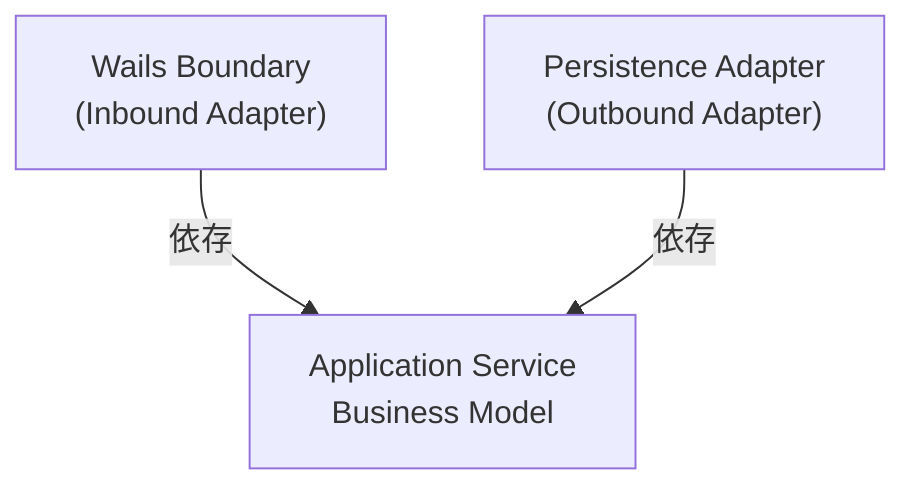
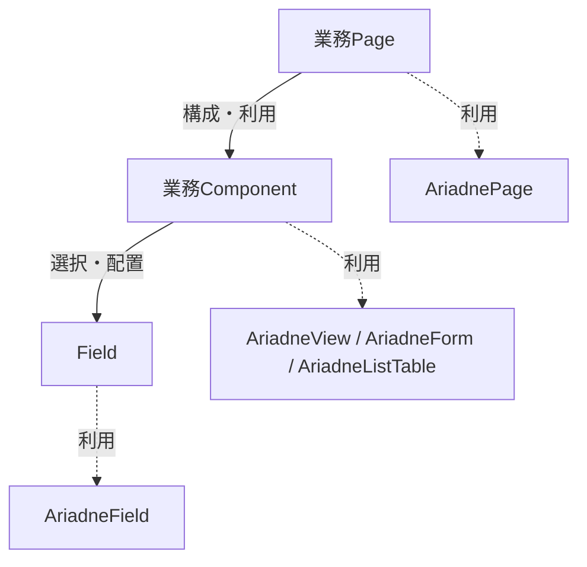

# Project ARIADNE — Prototype Phase 5：Windows Application (v2 Draft)

> **Status: DRAFT**  
> 本文書はPhase 5正本再構成（Issue #22）の作業用ドラフトである。A02〜A06で段階的に整備し、A07で正式切替が承認されるまで、現行正本 `phase-5-windows-application.md` を置き換えない。

## 1. Purpose & Scope

### 1.1 Purpose

Prototype Phase 5では、Svelte / Wails v3 / GoによるWindows Applicationを実装し、PROJECT ARIADNEのWindows Applicationとしての技術的成立性を検証する。

Task管理Applicationを題材に、Frontend、Wails Boundary、Application Service、File Persistenceを連携させ、Taskの参照・作成・編集・永続化・復元までを実際に動作させる。

本Phaseの目的は、Applicationが動作することの確認だけではない。採用したApplication Architectureについて、責務分離と境界が設計どおりに実装可能であることに加え、**その設計判断自体が妥当であるか**を実装・検証を通じて確かめる。

### 1.2 Design Principles

Phase 5では、以下の4原則に基づいて設計・開発する。

1. **理解と納得に基づく設計**  
   採用する設計の理由と選択肢を理解し、納得したうえで決定する。テルとアリアドネは、提案・疑問・反論を交わしながら設計判断を深める。既存の実装が動くことだけを理由に判断を固定しない。
2. **全体の整合性を守る**  
   個々の機能や局所的な実装の都合だけでなく、Architecture全体の責務境界、採用済み設計判断、関連文書との整合性を重視する。
3. **小さく成立させ、検証を通じて育てる**  
   完成形を一度に作り込まず、小さな単位で設計・実装・Test・Build・実機確認を繰り返す。未知の技術要素は段階的に検証し、その結果を次の判断に反映する。
4. **美しく、無理のない構造を選ぶ**  
   不必要な複雑さや先回りした抽象化を避け、責務が明確で、自然に成立する構造を選ぶ。実装コストだけでなく、構造のわかりやすさと将来の変更容易性を考慮する。

具体的な開発サイクル、Test・Buildの運用、設計判断の記録方法および協働の進め方は、第2章 Development Processで扱う。

### 1.3 Scope

Prototype Phase 5では、Task管理を題材として、以下を対象とする。

- Taskの一覧・詳細参照、新規作成、編集
- ローカルYAMLへのTask保存、およびApplication再起動後の復元
- TaskのValidationと、正常系・異常系のApplication内での伝達・処理
- Windows ApplicationとしてのUI、Build、Test、実機での起動・操作確認
- Frontend / Wails Boundary / Application Service / File Persistenceの連携、責務分離およびArchitecture設計判断の検証

Taskの**新規作成**は対象に含む。一方、Task管理環境の**初回初期化**（`tasks.yaml` が存在しない場合の初期化を含む）は対象外とし、Coreで扱う。Taskが0件であること自体は正常な状態として扱う。

Phase 2〜4で扱ったElements / API / DDLのモデルおよび変換構造を、Applicationから操作する機能は本Phaseの対象外とする。それらを扱うApplication機能やValidator / Resolver / Generator等の実装はCoreで扱う。

### 1.4 Completion Criteria

Phase 5の完了は、以下の観点で判断する。

1. **Applicationの成立**：Task管理の対象操作とYAML永続化・復元が、Windows Applicationとして動作する。
2. **Architectureの成立**：採用した責務分離と境界に基づいてApplicationを構成でき、その設計判断の妥当性を検証できている。
3. **検証の成立**：必要な自動Test、BuildおよびWindows実機での動作確認が成立している。
4. **判断の整理**：検証を通じて確定した重要な設計判断、残課題およびCoreへの引継ぎ事項が整理されている。

個別BehaviorやTestの詳細な合否条件は、第2〜4章および関連するBehavior Map・Test文書で定義する。

## 2. Development Process

### 2.1 Development Approach

PROJECT ARIADNEのPrototype Phase 5では、小さな単位で設計・実装・検証を繰り返す反復型の開発プロセスを採用する。

開発はPlanning、Design、Implementation & Test、Build & Verificationを基本的な活動として構成し、TDDを実装の基本手法とする。

各活動は一方向に完了するものではない。Testや実機確認によって設計上の問題、仕様の不足、計画の不整合が明らかになった場合は、必要な段階へ戻って見直す。

重要なのは、当初の計画を守り切ることではなく、実装と検証を通じて設計判断の妥当性を確かめ、Application全体を無理のない構造として成立させることである。

### 2.2 Planning Process

Phaseの目的とScopeを明確にしたうえで、実現する主要なBehaviorをBehavior Mapとして整理する。

Behaviorは原則として1つのユーザーActionを基本単位とし、同じActionに対する結果の分岐はResult Patternとして整理する。各Behaviorについて、開始状態、Action、結果、Frontend / Backendの関与を明らかにする。

Behavior Mapは、Test対象を整理するためだけの文書ではない。Phase全体で実現する振る舞いを俯瞰し、Stepの分割と実施順序を検討するための入力情報とする。

Stepは、機能間の依存関係と段階的な検証の成立順序を考慮して分割する。各Stepでは、必要な課題検討、設計、実装、検証を小さな単位で進められることを重視する。

後続Step固有の詳細仕様を先行して決定しなければ現在のStepが成立しない場合は、安易に先回りするのではなく、Behavior MapやStepの分割・順序が適切かを再検討する。

ただし、現在のStepで設計する共通機構について、既知の後続Behaviorとの整合性を考慮することは妨げない。

Behavior MapとStep計画は固定的なものではない。開発中に新たなBehaviorや依存関係が明らかになった場合は、必要に応じて更新する。

### 2.3 Design Process

各Stepでは、実装に先立って課題検討と設計を行う。

まず、実現したいこと、前提条件、制約、既存の設計判断、未決定事項を整理する。そのうえで、責務境界と必要な構造を検討し、実現方法を具体化する。

設計では、最初に挙がった案や既存実装を無条件に採用しない。必要に応じて代替案を比較し、それぞれの成立条件、複雑さ、トレードオフを明らかにする。

設計判断は、その理由を理解し、納得したうえで確定する。重要な判断は、第3章Application Architecture、第4章Application Specificationなど、該当する正本へ反映する。

Testや実装を通じて設計の不足・矛盾が明らかになった場合は、設計へ戻る。問題がBehaviorの定義やStepの分割・実施順序に及ぶ場合は、Planning Processまで戻って見直す。

Testを通すためだけに、不自然な構造や例外的な処理を積み重ねない。

### 2.4 Implementation & Test Process

#### Test Strategy

PROJECT ARIADNEでは、Testを技術要素ではなく、保証する範囲によって分類する。

基本戦略は、Frontend Module Test（FMT）とBackend Module Test（BMT）によってBehaviorを保証することである。

**Frontend Module Test（FMT）**

対象BehaviorのFrontend側の振る舞いを、公開されたSvelte Componentの適切な境界から確認する。

Backendを利用する場合はWails Public APIをMockし、ユーザー操作に対する表示、状態変化、Validation Message、Toastなどを確認する。

子Component単位で網羅的にTestすることは目的とせず、1 Behavior = 1 Component = 1 Test Fileとも規定しない。

VitestとSvelte Testing Libraryを使用する。Test Codeは実装と分離したTest用Directoryに配置し、Behavior単位で整理する。

**Backend Module Test（BMT）**

対象BehaviorのBackend側の振る舞いを、Frontendに公開するWails Public APIではなく、その内側にあるApplication Serviceの公開APIを直接呼び出して確認する。

Test Codeは実装とは分離したTest用Packageに配置し、Behavior単位で整理する。1 Behavior = 1 Test Fileとは規定せず、Result PatternやTest Caseに応じて複数ファイルへ分割してよい。

File I/Oを伴う場合も、原則としてFile SystemをMockせず、`t.TempDir()`などで用意した一時Directory上で実際のFile AdapterとFile I/Oを使用する。

Application ErrorはServiceの公開APIを通じて分類とError Chainを確認する。Wails PublicErrorへの変換はBMTの対象外とする。

**Logic / Development Step Test**

FMT/BMTのModule TestだけではTest Patternが過大になる複雑なLogicや、未知の技術要素を段階的に検証する場合に限り、補助的に使用する。

Development Stepとして作成したTestは、上位のModule Testが成立した後、継続して保証する価値がなければ削除してよい。

Logic / Development Step Testは通常の`test.sh`およびBuild Gateには含めない。必要な場合は`backend-test.sh --logic`で実行する。

#### Behavior Test Specification

Behavior Mapで定義したBehaviorについて、各Stepの課題検討・実装設計を終えた後、実装直前にBehavior Test Specificationを具体化する。

Behavior Test Specificationでは、Result Patternごとに必要なFrontend / Backend Testを検討し、Dependency、Given、When、Expectedを明らかにする。

Behavior Mapは振る舞いの正本、Behavior Test Specificationはその保証方法を定義する文書とする。

1つのResult Patternを複数のTest Caseで確認してよい。特にBackendでは、Application上同じ結果になる複数の失敗原因を、必要に応じて個別に検証する。

TestのGivenを構築するために先行Behaviorの機能を利用する場合は、依存先をBehavior Test Specificationに明記する。先行Behaviorの保証内容を重複してTestすることは目的とせず、依存先のTestがGREENであることを前提とする。

Behavior Test Specificationは、Test Codeの内部実装を詳細設計するための文書ではない。

#### TDD Implementation Cycle

Behavior Test Specificationに基づき、実装より先にModule Testを作成する。

Module Testは対象Behaviorの完成条件を示すものであり、GREENにするための最短経路で実装することは目的としない。

基本サイクルは次のとおりとする。

1. 対象BehaviorとResult Patternを選択する。
2. 必要なModule Testを作成し、REDとなることを確認する。
3. 既存のModule TestのGREENを維持しながら、小さな技術的・機能的単位で実装を進める。
4. 必要に応じてLogic / Development Step Testを利用し、段階ごとに動作を確認する。
5. 新たに作成したModule Testを含め、すべてのModule TestがGREENとなることを確認する。
6. 必要に応じてRefactorし、再びALL GREENを確認する。

新たなModule TestがREDである間も、既存のModule TestはGREENを維持することを原則とする。

実装中に設計上の疑問が生じた場合は、必要な設計判断へ戻る。問題がStep計画に及ぶ場合はPlanning Processまで戻る。

### 2.5 Build & Verification Process

Implementation & Test Processで成立した実装を、Windows ApplicationとしてBuildし、実機で確認する。

日常的なModule Testの統一入口は`test.sh`とする。

`test.sh`は`backend-test.sh`と`frontend-test.sh`を実行し、両方がPASSした場合のみPASSとする。Logic / Development Step Testは通常実行に含めない。

Frontend / Backendの各Test Scriptは、日常的に確認しやすいコンパクトな結果表示とする。TestごとのPASS / FAIL、Total、Error Rate、実行時間を基本とし、Errorの詳細はFailure時に表示する。冗長なDOMやStack Traceなどのノイズを抑制する。

`build.sh`は、既存のBuild成果物を削除した後、`test.sh`をBuild Gateとして実行する。

Module TestがすべてPASSした場合のみWails ApplicationをBuildする。FAILした場合はBuildせず、以前の成果物も残さない。

Build後は、Windows実機でApplicationを起動し、操作、画面表示、状態遷移、FrontendからBackendおよびFile Persistenceまでの連携を確認する。

CSS、Layout、Color、Spacing、SizeなどのVisual Designは、原則として自動Module Testの保証対象とせず、実機で確認する。

一方、表示の有無、Validation Message、Toast、画面状態の変化など、Behaviorとして意味を持つUI状態はFMTの対象とする。

Buildと実機確認はModule Testの代替ではない。異なる保証範囲を持つ検証として組み合わせる。

### 2.6 Communication & Collaboration

PROJECT ARIADNEでは、テルとアリアドネが対話を通じて設計・開発を進める。

テルは、実現したいこと、目的、譲れない条件を提示し、設計判断を確定する主体となる。

アリアドネは、目的や課題の構造化、実現方法の提案、代替案の比較、疑問・矛盾の指摘、反論、記録の整理を担う。

両者は単に提案と承認を繰り返すのではなく、設計判断の理由を共有し、理解と納得に至るまで議論する。

アリアドネはテルの提案を無条件に肯定しない。既存実装や過去の決定についても、必要であれば疑問を呈する。

一方、テルが設計上の疑問を持っている段階で、アリアドネが先行して実装を進めない。

設計判断が確定したら、小さな単位で実装・検証を進め、結果を共有する。問題が見つかった場合は、原因と影響範囲を確認し、必要な段階へ戻って協議する。

### 2.7 Development Artifacts & Management

PROJECT ARIADNEでは、設計判断を保持するDocument、BehaviorとTestの関連文書、作業管理情報、Source Codeについて、それぞれの役割と更新方法を区別する。

設計判断の継続的な参照先は正本とし、IssueやPull Requestを正本の代替としない。

| 対象 | 役割 | 更新方式 | 管理方針 |
| --- | --- | --- | --- |
| Phase正本 | 目的、設計原則、Architecture、Application Specificationなどの重要な設計判断を保持する | PR運用（アリアドネ） | 設計判断の確定・変更時に更新する |
| Behavior Map | Phase全体のBehaviorを整理し、Step計画の入力とする | PR運用（アリアドネ） | Phase開始時に作成し、Behaviorや計画の変更に応じて更新する |
| Behavior Test Specification | BehaviorごとのTest対象、条件、期待結果を定義する | PR運用（アリアドネ） | 各Behaviorの実装直前に具体化し、変更に応じて更新する |
| Validation Rules | FieldおよびCorrelation Validationの判定条件を定義する | PR運用（アリアドネ） | 独立Documentとして維持するか第4章へ統合するかは、第4章の再編集時に判断する |
| GitHub Issue | Activity、Task、未決定事項、進捗、検討結果を管理する | 直接更新（アリアドネ） | 作業や検討の進行に合わせて更新する |
| Source Code | Applicationの実装を保持する | PR運用（テル） | テルが自ら実装し、変更を管理する |

DocumentationのPR運用では、アリアドネがBranch上で編集・Commitし、Pull Requestを作成する。テルがレビューし、合意後にMergeする。

Source Codeの実装・変更・Mergeはテルが行う。

各Stepの完了時には、実装・検証結果、確定した設計判断、残課題を整理し、必要なDocumentとIssueを更新する。

## 3. Application Architecture

### 3.1 Architecture Overview

PROJECT ARIADNEでは、**Go Service First**を基本方針とし、Application Serviceを中心としたArchitectureを採用する。

**Frontend、Wails Boundary、Backendの3つをApplicationの基本構造とし、BackendにApplication Serviceが含まれる。**

Frontendは画面表示・入力および画面状態を扱い、Wails Boundaryを通じてBackendの機能を利用する。BackendはApplication Serviceを中心に業務処理と永続化を担う。

各構成要素の内部構造と責務は、後続の節で定義する。

#### Architecture Principles

##### Go Service First

Application Serviceは、Wailsに依存しない通常のGo Serviceとして実装する。

WailsはFrontendとBackendを接続するために利用し、業務処理をWails固有の実装へ持ち込まない。

##### Model Separation

Application内部では、責務に応じてモデルと状態の表現を分離する。

Backendでは、以下の3種類のモデルを区別する。

- **Business Model**：業務上の概念と成立条件を表す。
- **Public Model**：Application Serviceが提供するOperationの入出力契約を表す。
- **Persistence Model**：永続化方式に適したデータ表現を表す。

Public ModelはBusiness Modelの完全な写像ではない。取得系ではBusiness Modelの必要な側面を公開し、登録・更新系ではBusiness Modelを成立・変更させるための要求を表す。Business ModelとPublic Modelは一対一に対応する必要はない。

Frontendでは、Public Modelをそのまま画面の状態として扱うとは限らない。公開IFの表現をFrontendで扱いやすい形に整え、表示、入力、操作に必要なStateを管理する。

各モデルの変換責務はBackend Architectureで、Frontend内部の状態管理と公開IFへの適合はFrontend Architectureで定義する。

##### Persistence Independence

Application Serviceは、具体的な永続化方式に依存せず、Persistence Portを介して永続化操作を要求する。

Application Serviceが定義するPersistence PortをPersistence Adapterが実装する。

Application ServiceはPersistence Modelを認識せず、永続化方式に必要な変換と読み書きはPersistence Adapterが担当する。

Package間の依存方向およびPort / Adapterの詳細はBackend Architectureで定義する。

##### Wails Boundary

FrontendとApplication Serviceの接続にはWails v3を使用する。

Wails Boundaryは公開APIとデータの受け渡しを担う。Frontendとの境界を越えて受け渡すデータにはPublic Modelを使用し、Business Modelを直接公開しない。

Wailsが生成するBindingはFramework管理のコードとして扱い、手動編集しない。

公開API、Bindingおよび境界でのエラー変換はWails Boundaryで定義する。

##### Source of Truth

Applicationが管理するデータのSource of Truthは、Persistence Adapterを通じて永続化されたデータとする。

Frontend StateやApplication Service内のBusiness Modelは、永続化データの正本とはしない。

Prototypeでは、File Persistence Adapterを使用し、ローカルYAMLを永続化先とする。

具体的な永続化方式、データ構造および読み書きの仕様はApplication Specificationで定義する。

### 3.2 Backend Architecture

#### 3.2.1 Backend Structure

Backendでは、**Business Modelを中心にApplicationを構成する。**

Business Modelは業務上の概念と成立条件を表し、**そのモデルが成立している限り、業務上の条件が満たされていることを保証する。** 不正な状態のBusiness Modelを生成・変更・復元させないことを設計上の責任とする。

Application Serviceが業務処理を担い、Persistence AdapterがBusiness Modelの保存・復元を担う。

Wails BoundaryとPersistence Adapterは、いずれもApplication Service側に依存するAdapterとして位置づける。

図の矢印は、処理やデータの流れではなく、**ソースコード上の依存方向**を示す。Wails BoundaryはApplication ServiceのOperationを呼び出し、Persistence AdapterはApplication Service側で定義されたPersistence Portを実装する。

Persistence Portは、Application Serviceが永続化に対して要求できる操作を定義するInterfaceであり、Application Serviceと同じPackageに配置する。これにより、Application ServiceはPersistence Adapterの具体的な実装に依存しない。

Persistence Portは、Application Serviceが必要とする操作を契約として定義する。操作の命名と粒度は、永続化技術の機能ではなく、Application Serviceが表現したい操作意図に基づいて決定する。

#### 3.2.2 Application Service

Application Serviceは、Business Modelを中心に、Applicationが提供する業務処理を実現する。

Business Modelが保証する成立条件を前提として、Operationに必要な処理を組み立てる。

主な責務は以下とする。

- Business Modelを用いた業務処理の実行
- Public ModelによるOperationの入出力契約の定義
- Business ModelとPublic Modelの相互変換
- Persistence Portを介したBusiness Modelの取得・保存要求

Application Serviceは、Frontendの画面表示や具体的な永続化方式を認識しない。

#### 3.2.3 Persistence Adapter

Persistence Adapterは、Business Modelの保存・復元を実現する。

永続化方式に応じたPersistence Modelを定義し、Business Modelとの相互変換を担当する。

Application Serviceが操作の意図を決定し、Persistence AdapterはPersistence Portで定義された契約に従って実行する。

Persistence Adapterは、具体的な保存形式や入出力処理を担当する。

#### 3.2.4 Model Separation

Backendでは、**Business Modelを中心とし、目的に応じてPublic ModelとPersistence Modelを定義する。**

Public Modelは、Business Modelを外部から利用するための表現であり、Application Serviceが提供するOperationの入出力契約を表す。Business Modelの完全な写像である必要はない。

Persistence Modelは、Business Modelを永続化方式に適合させた表現であり、保存・復元に使用する。

Persistence Modelには、`createdAt`・`updatedAt`のような記録管理用Timestampを持たせることができる。これらはBusiness Modelの成立条件を表すものではなく、Business Modelには含めない。記録管理用TimestampはPersistence Adapterが生成・維持し、画面表示には使用しない。業務上必要な日時情報は、Business Modelに別途定義する。

Business ModelとPublic Modelは、それぞれ独立したPackageで定義する。

モデル間の変換責務は以下とする。

| 変換 | 担当 |
| --- | --- |
| Business Model ↔ Public Model | Application Service |
| Business Model ↔ Persistence Model | Persistence Adapter |

Application ServiceはPersistence Modelを認識せず、Persistence AdapterはPublic Modelを認識しない。

### 3.3 Frontend Architecture

#### 3.3.1 Frontend Structure

Frontendの画面は、**業務Page、業務Component、Fieldの3階層**で構成する。

各階層は、必要な下位要素を構成し、Ariadne系の共通Componentを利用して共通の表示構造や振る舞いを備える。Ariadne系Componentは独立した階層ではない。

図の実線は画面構成上の3階層の関係、破線は各階層が共通Componentを利用する関係を示す。処理の実行順序やデータ変換経路、厳密なSvelte Componentの包含関係を示すものではない。

##### Field

Fieldは、個々の値の表示・入力を担当する。Text、Textareaなどの汎用Fieldに加え、業務固有の意味や表示方法を持つFieldを定義できる。

Fieldは`AriadneField`を利用し、Label、Value、Errorの共通構造と装飾を備える。個々のFieldは値の種類に応じた表示・入力方法を担当する。

Fieldの表示形態は`reference`（参照表示）、`edit`（入力・変更）、`cell`（一覧表のセル表示）を区別する。各Fieldは用途に応じて必要な表示形態を実装し、3形態すべてを一律に要求しない。

##### 業務Component

業務Componentは、必要なFieldを選択し、値を割り当て、組み合わせと配置を決定する。

業務Componentは、用途に応じて`AriadneView`、`AriadneForm`、`AriadneListTable`などを利用し、共通の表示・入力構造と振る舞いを備える。業務Component自身が、Field群の構成と利用する共通Componentの両方を決定する。

- `AriadneView`：参照表示の共通構造とスクロール
- `AriadneForm`：入力領域の共通構造、スクロール、Submit受付、操作ボタンの配置
- `AriadneListTable`：一覧表示の共通構造、行・列の表示、スクロール

Tableにおける行・列・セルの構成と業務Componentの責務分担は、Snippet等の利用も含めて別途具体化する。

##### 業務Page

業務Pageは、画面全体を構成し、必要な業務Componentを利用する。

業務Pageは`AriadnePage`を利用し、HeaderとContentsの共通構造を備える。`AriadnePage`はContents自体のスクロールを管理せず、必要なスクロールは内部のComponentが担当する。

業務PageはStore / Contextと業務Componentを結びつけるが、Backendを直接呼び出さない。データ変換、入力値の再構成、更新処理の連携は3.3.2で定義する。

##### Modal / Toast

Confirmation ModalとNotification Toastは、画面構成の3階層とは別に、複数の画面から利用する共通Componentとする。

- **Confirmation Modal**：意思確認を行い、判断結果を呼び出し元へ返す。業務処理の実行やNavigationの確定は担当しない。
- **Notification Toast**：指定された通知内容を表示する。通知内容の決定や業務処理の結果判定は担当しない。

Form利用時の意思確認と正常な登録・更新結果の通知は3.3.2、未保存変更がある場合の離脱確認は3.3.3、Error通知とLoggingの関係は3.5で定義する。
