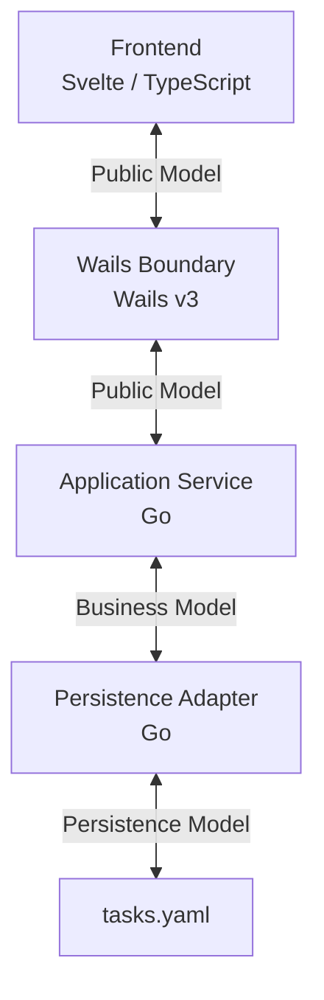
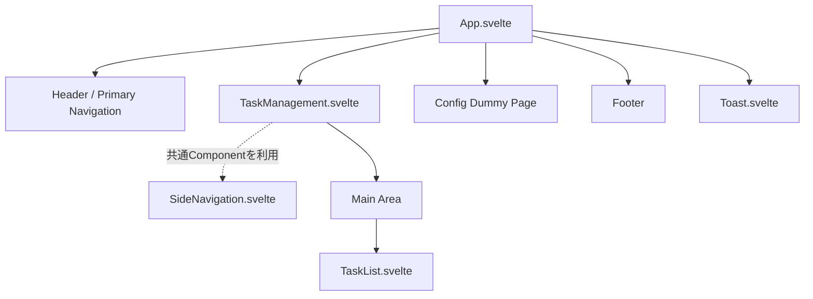

# Project ARIADNE — Prototype Phase 5：Windows Application

**Status:** IN PROGRESS

---

## 1. 目的

Prototype Phase 5では、Svelte + Wails v3 + GoによるWindows
Applicationを実装し、 Project ARIADNEのWindows
Applicationとしての技術的成立性を検証する。

Phase 0で定義したとおり、Prototype
ApplicationではTask管理アプリを題材として、
以下の一連の動作を実際に実装・確認する。

- ローカルYAMLからTaskを読み込む
- Task一覧を画面へ表示する
- Taskを新規作成する
- Taskを編集する
- TaskをローカルYAMLへ保存する
- Application再起動後に保存内容を復元する
- Svelte / Wails / Go間で正常系・異常系を適切に伝達する
- Windows実行ファイルとしてBuildし、単体で起動・操作できることを確認する

Prototype Phase 5は、Phase 2〜4で設計したElements / API /
DDLをApplicationから操作するPhaseではない。

Elements / API /
DDLについてはPrototypeではモデルおよび変換構造の設計検証までとし、
それらを扱うApplication機能、Validator / Resolver /
Generator等の実装はCoreで行う。

---

## 2. Protptype の基本方針

Prototype では、完成形を事前に詳細設計してから実装するのではなく、
小さな機能単位で実装・テスト・Build・実機確認を繰り返しながら進める。

基本方針を以下とする。

- 小さな単位で機能追加しながら進める
- 詳細な設計ドキュメントの作成は必須としない
- 実装を通じて確定した重要な設計判断や、後から参照する価値のある事項のみ本ドキュメントへ記載する
- コードから明らかな内容をドキュメントへ重複記載しない
- Prototypeでは内部Databaseを使用せず、Fileを使用する
- 機能追加の節目ごとにBuildを行い、リリースモジュールとして実際に起動・操作できることを確認する
- テストを通過していない状態ではBuildしない
- `test.sh` / `build.sh` をPhase
  5初期に整備し、その後の開発サイクルの基盤とする
- 未知の技術要素については、一度に完成形まで実装せず、小さな単位で動作を確認しながら段階的に進める

Prototype では、動くApplicationを作ることだけでなく、 Svelte / Wails / Go /
Fileの責務を説明できる状態で実装することを重視する。

---

## 3. Application Architecture

### 3.1 Architecture Overview

PROJECT ARIADNE では、**Go Service First** を基本方針とし、Application Serviceを中心としたアーキテクチャを採用する。

Frontend、Wails Boundary、Application Service、Persistence Adapterの責務を分離し、それぞれの境界で扱うデータモデルを明確にする。

#### Architecture Diagram



この図は、Applicationの主要な構成要素と、それぞれの境界で受け渡すデータモデルを示す。

矢印はデータの受け渡しを模式的に表しており、Package間の依存方向や、実際の呼び出し経路を厳密に表すものではない。

#### Architecture Principles

##### Go Service First

Application Serviceは、Wailsに依存しない通常のGo Serviceとして実装する。

WailsはFrontendとBackendを接続するために利用し、業務処理をWails固有の実装へ持ち込まない。

##### Model Separation

Application内部では、以下の3種類のモデルを明確に分離する。

- **Business Model**：業務上、本来あるべきデータの姿を表す。
- **Public Model**：Application Serviceの入出力契約を表す。取得結果だけでなく、Create / Modify等の入力モデルも含む。
- **Persistence Model**：YAMLやDB等の永続化方式に適したデータの姿を表す。

Business Modelをそのまま外部へ公開せず、必ず独立したPublic Modelを使用する。

Application ServiceはBusiness ModelとPublic Modelを認識し、公開する情報の範囲と表現を決定する。

一方、Persistence Modelは永続化技術に依存するため、Application Serviceからは認識しない。

##### Persistence Independence

Application ServiceはPersistence Portを介してデータの永続化を要求する。

Persistence PortはBusiness Modelを扱うInterfaceとして定義し、File Persistence Adapterがこれを実装する。

File Persistence AdapterはBusiness ModelとPersistence Modelの相互変換、およびローカルYAMLへの読み書きを担当する。

これにより、Application Serviceを特定の永続化方式から独立させる。

なお、Architecture Diagramでは全体像を優先してPersistence Portを省略している。具体的な依存関係と変換責務はSection 3.2で定義する。

##### Wails Boundary

FrontendとApplication Serviceの接続にはWails v3を使用する。

Wails Boundaryでは公開APIを制御し、Frontendとのデータ受け渡しにはPublic Modelを使用する。

Wailsが生成するBindingはFramework管理のコードとして扱い、手動編集しない。

公開メソッド、Binding、エラー変換の詳細はSection 3.3で定義する。

##### Source of Truth

Prototype では、TaskデータのSource of Truthをローカルの `tasks.yaml` とする。

Frontendの状態やApplication Service内のBusiness Modelは、永続化されたTaskデータの正本とはしない。

YAMLの具体的な構造とPersistence Modelの定義はSection 5で扱う。

---

### 3.2 Backend Architecture

Backendは、Application Service、Persistence Port、Persistence Adapterを中心に構成する。

Application ServiceはBusiness Modelを中心にユースケースを実現し、Public Modelによって外部との入出力契約を定義する。

Persistence Adapterは永続化技術を担当し、Persistence Portを介してApplication Serviceから利用される。

#### 3.2.1 Model Separation

Backendでは、以下の3種類のモデルを独立して定義する。

| Model             | Purpose                                   | Application Serviceからの認識 |
| ----------------- | ----------------------------------------- | ----------------------------- |
| Business Model    | 業務上、本来あるべきデータを表現する      | 認識する                      |
| Public Model      | Application Serviceの入出力契約を表現する | 認識する                      |
| Persistence Model | 永続化方式に適したデータを表現する        | 認識しない                    |

Business ModelとPublic Modelは、必ず異なるPackageで定義する。

Public Modelには、取得結果のモデルだけでなく、Create / Modify等の入力モデルも含める。

取得用のPublic Modelを、そのまま登録・更新用の入力モデルとして流用しない。

Public Modelは、Business Modelと同じ名称を使用してもよい。両者は異なる責務を持つ独立したモデルであり、同じ概念であっても値の表現が異なる場合がある。

例えばTaskの任意項目 `description` は、Business Modelでは未設定を `nil` として扱い、Public Modelでは空文字列として公開する。

Persistence Modelは、YAMLやDB等の永続化方式に合わせたモデルであり、Application Serviceの入出力契約には使用しない。

#### 3.2.2 Application Service

Application Serviceは、Frontendから要求されるApplication Operationを実現する。

主な責務は以下とする。

- Business Modelの成立条件を管理し、ユースケースを実現する
- Public Modelによって外部への入出力契約を定義する
- Business ModelとPublic Modelの相互変換を行う
- Persistence Portを介してデータの取得・格納を要求する

Application Serviceは、Frontendの表示方法やWails固有の処理を認識しない。

また、YAML Format、File I/O、Persistence Model、ULID生成方式、Timestampの取得・維持といった永続化技術の詳細も認識しない。

Prototypeでは以下のOperationを基本とする。

```text
ListTasks()
GetTask(ID)
CreateTask(Properties)
ModifyTask(ID, Properties)
```

各Operationの入出力にはPublic Modelを使用する。具体的なTaskモデルと入力項目はSection 5で定義する。

Create / Modifyの入力モデルについては、操作ごとに独立したモデルを使用する方針とする。ただし、具体的な型、IDの受け渡し方法、未指定・null・値ありの表現方式はPhase 5 TODO:とする。

#### 3.2.3 Persistence Port

Persistence Portは、Application Serviceが永続化に対して要求できる操作を定義するInterfaceである。

Persistence PortはBusiness Modelを扱い、Persistence Modelを公開しない。

Prototypeでは以下のOperationを基本とする。

```text
Retrieve()
Pick(ID)
Store(Task, StoreIntent)
```

- `Retrieve`：格納されているTask群を取得する
- `Pick`：IDを指定して1件のTaskを取得する
- `Store`：Taskを格納する

`StoreIntent` は格納操作の意図を明示する。

```text
Deposit
    新しいTaskを初めて格納する

Replace
    既存のTaskを置き換える
```

Persistence AdapterはTaskの状態から格納Intentを推測しない。

将来、`Retrieve` に取得条件が必要になった場合は、Conditions / Order / Range等を含むCriteriaの導入を検討する。Prototypeでは実装しない。

#### 3.2.4 Persistence Adapter

Persistence AdapterはPersistence Portを実装し、具体的な永続化方式を担当する。

Prototype ではFile Persistence Adapterを使用し、ローカルYAMLへの永続化を行う。

主な責務は以下とする。

- `tasks.yaml` のRead / Write
- YAML Parse / Serialization
- `format / version` Validation
- Persistence ModelとBusiness Modelの相互変換
- Deposit時のULID生成
- `createdAt / updatedAt` の生成・維持
- Temporary Fileへの全量WriteとCanonical FileへのReplaceによるSafe Write

Persistence Adapterは、Persistence Portで定義されたBusiness Modelを受け取り、永続化方式に適したPersistence Modelへ変換する。

取得時にはPersistence ModelをBusiness Modelへ変換して返却する。

#### 3.2.5 Dependency and Conversion Boundaries

Backendの依存関係とモデル変換の責務は、以下の原則に従う。

| Boundary               | Model Conversion                   | Responsibility      |
| ---------------------- | ---------------------------------- | ------------------- |
| Public ↔ Business      | Public Model ↔ Business Model      | Application Service |
| Business ↔ Persistence | Business Model ↔ Persistence Model | Persistence Adapter |

Application ServiceはPersistence PortのInterfaceに依存し、Persistence Adapterの具体的な実装には依存しない。

Persistence AdapterはPersistence Portの契約に従って動作する。

これにより、公開契約の変更と永続化方式の変更を、それぞれ独立した責務として扱える。

---

### 3.3 Wails Boundary

Wails Boundaryは、FrontendとGo Application Serviceを接続するApplication境界である。

Application ServiceはWailsに依存せず、Wails BoundaryがFrontendへ公開するOperationとErrorの表現を制御する。

#### 3.3.1 Public API

Frontendへ公開するMethodは、Wails Boundaryで明示的に定義する。

Application ServiceのMethodを無条件にFrontendへ公開するのではなく、Wails Boundaryを通じて公開範囲を制御する。

Prototypeでは以下のOperationを基本とする。

```text
ListTasks()
GetTask(ID)
CreateTask(Properties)
ModifyTask(ID, Properties)
```

Wails Boundaryは、Frontendからの要求を対応するApplication ServiceのOperationへ委譲する。

Business Logic、Task Validation、Persistence処理はWails Boundaryに実装しない。

#### 3.3.2 Public Model and Binding

FrontendとWails Boundaryの間ではPublic Modelを使用する。

Public ModelはApplication Serviceの入出力契約であり、Business Modelとは独立したPackageで定義する。

Wails BoundaryはBusiness Modelを直接Frontendへ公開しない。

Wailsが生成するTypeScript BindingおよびModelはFrameworkが管理する成果物として扱い、手動編集しない。

```text
Frontend
    ↓
Generated TypeScript Binding
    ↓
Wails Runtime
    ↓
Wails Boundary
    ↓
Application Service
```

Public ModelからFrontend向けのTypeScript表現への変換は、WailsのBinding生成・Runtimeによって行われる。

Wails Boundaryは公開範囲と接続を担当し、Public Modelの業務上の意味や項目構成を独自に決定しない。

Create / Modifyの入力モデルについては、Public Modelを使用する原則を適用する。ただし、具体的な型とWailsを介した値の受け渡し方式は、当該Behaviorの実装時に検証する。TODO:

#### 3.3.3 Error Boundary

Wails Boundaryは、Backend内部で発生したErrorをFrontend向けの公開用Errorへ変換する。

Backend内部のError ChainをFrontendへ直接公開せず、公開用Messageと処理済みであることを示す情報を伝達する。

Frontend向けのErrorは、以下の構造を基本とする。

```go
type PublicError struct {
    Processed bool
    Message   string
}
```

`Processed` は、Wails Boundaryで公開用に処理されたErrorであることを表す。

`Message` は、Frontendへ表示する公開用Messageである。

Application Error Codeは設けない。

Prototypeでは、Wails Boundaryによるpanicの捕捉・回復処理は実装しない。

通常のBackend Errorについては、Wails Boundaryで公開用Errorへ変換する。

#### 3.3.4 Wails Error Conversion

Wails v3では、Go側から返却されたErrorがWails Runtimeを経由し、FrontendではJavaScriptのErrorとして受け取られる。

BackendのWails Boundaryで生成した `PublicError` は、Wails Runtimeによる変換後、Frontendでは `Error.cause` に格納される。

```text
Backend
    PublicError
        Processed = true
        Message = 公開用Message
            ↓
        Wails Runtime
            ↓
Frontend
    Error
        cause
            Processed = true
            Message = 公開用Message
```

Frontendでは、`Error.cause.Processed == true` によって、Wails Boundaryで公開用に処理されたErrorであることを識別する。

公開用Messageは `Error.cause.Message` から取得する。

Frontendにおける処理済みErrorの識別と、未処理Errorに対するFallbackはSection 3.5.3で定義する。

#### 3.3.5 Error Boundary Verification

Wails BoundaryにおけるError変換・伝搬は、テストの保証範囲を分けて検証する。

| Test                          | Guarantee                                                 |
| ----------------------------- | --------------------------------------------------------- |
| Backend Module Test           | Application Serviceの公開APIからBackend Errorの分類を検証 |
| Logic / Development Step Test | Wails BoundaryにおけるPublicErrorへの変換処理             |
| Frontend Module Test          | Wails変換後のErrorを受け取った際のFrontendの振る舞い      |
| Integration Test              | 実際のWails Runtimeを通じたError変換・伝搬                |

Wails BoundaryのError変換処理は、Backend Module Testの対象に含めず、Logic / Development Step Testで補助的に検証する。

Frontend Module Testでは、Wails Runtimeによる変換後のError形状をMockで再現する。

Wails Runtimeによる実際のError変換・伝搬はMockでは保証できないため、代表的なErrorを使用したIntegration Testで確認する。

Errorの種類ごとにWails Runtimeの変換を網羅的に再検証するのではなく、共通の変換機構として保証する。

具体的なTest CaseとIntegration Test対象は、Behavior MapおよびTest Specificationで管理する。

---

### 3.4 Frontend Architecture

FrontendはSvelte / TypeScriptで構成し、画面表示、ユーザー操作、Frontend State、Application Serviceとの連携を担当する。

Frontendでは、Componentによる表示責務と、TypeScript Moduleによる状態管理・処理責務を分離する。

BackendのBusiness Modelを直接扱わず、WailsのGenerated Bindingを通じてPublic Modelを取得・操作する。

#### 3.4.1 Component Structure

Frontendは、Application全体を構成するComponent、各機能を管理するComponent、および複数の機能から利用可能な共通Componentに分けて構成する。

Prototypeでは、以下のComponent構造を基本とする。



実線はComponentの構成関係を示す。

破線は共通Componentの利用関係を示す。`SideNavigation.svelte` はTask専用ではなく、他の機能からも利用できる共通Componentとして実装する。

各Componentの責務は以下とする。

| Component       | Responsibility                                               |
| --------------- | ------------------------------------------------------------ |
| App             | Application全体の構成、Primary Navigation、Toast Stateの管理 |
| TaskManagement  | Task機能内のNavigationとMain Areaの管理                      |
| SideNavigation  | 渡されたNavigation項目の表示と、ユーザー操作の通知           |
| TaskList        | Task一覧の表示                                               |
| Toast           | Notificationの表示                                           |
| Header / Footer | Application共通情報の表示                                    |

SideNavigationは、ユーザーの選択操作を通知するが、Navigationの成立可否や遷移先の確定は担当しない。

TaskListは、取得処理やNavigationの判断を担当せず、受け取ったTask一覧を表示する。

Configへの切替時にはTaskManagementを破棄し、Task機能に属するStateを維持しない。

Create / Edit、Confirmation Modal、Field Validation等のComponent構造は、対象Behaviorの実装時に具体化する。TODO:

#### 3.4.2 State Management

Frontendでは、Stateの用途と有効期間に応じて管理責務を分離する。

Application全体で必要なStateはAppが管理し、特定の機能に属するStateは、その機能を管理するComponentまたはTypeScript Moduleが保持する。

PrototypeのTask管理機能では、Navigation Stateと、各画面で利用するデータを区別して管理する。

##### Task Management State

Task管理機能では、以下の責務分担とする。

| Element        | Responsibility                                              |
| -------------- | ----------------------------------------------------------- |
| TaskManagement | Navigation操作の受付、画面遷移の制御、表示画面の切替        |
| TaskContext    | 遷移準備中・確定済みの画面と、その画面で利用するStoreの管理 |
| TaskListStore  | BackendからのTask一覧取得と、取得したTask一覧データの保持   |
| TaskList       | TaskContextを通じて取得したデータの表示                     |

`TaskContext` は、遷移準備中のStateと確定済みのStateを区別する。

画面遷移に必要なデータは、遷移を確定する前に準備する。

準備が成功した場合のみ、TaskContextのStateを確定する。準備に失敗した場合は、現在のStateを維持する。

具体的なNavigationの振る舞いはSection 3.4.3で定義する。

##### Task List Data

Task一覧の取得と保持には `TaskListStore` を使用する。

```text
TaskManagement
    ↓ 遷移準備を要求
TaskContext
    ↓ TaskListStoreを生成
TaskListStore
    ↓ ListTasks()
Wails Generated Binding
    ↓
Application Service
    ↓ Task一覧を返却
TaskListStore
    ↓ 取得データを保持
TaskContext
    ↓ 遷移確定後にデータを提供
TaskList
    ↓
画面表示
```

`TaskListStore` は、生成時にBackendからTask一覧を取得し、その結果を保持する。

`TaskContext` は、現在の画面に対応するStoreを管理し、表示Componentからのデータ取得要求に応じて、そのStoreのデータを提供する。

`TaskList` は、Task一覧の取得処理やStoreの生成を担当しない。

##### State Lifecycle

Task管理機能のStateは、TaskManagementの有効期間に属する。

Primary NavigationでConfigへ切り替えた場合は、TaskManagementとともにTaskContextおよび保持するStoreを破棄する。

Task機能へ再度切り替えた場合は、新しいTaskContextを使用する。

初期表示時におけるデータ取得の扱いについては、Coreで検討する。

#### 3.4.3 Navigation

FrontendのNavigationは、Application全体の機能を切り替えるPrimary Navigationと、各機能内の画面を切り替えるNavigationに分かれる。

それぞれのNavigation Stateは、対応する管理Componentが所有する。

##### Primary Navigation

Primary Navigationは、Application全体の機能切替を担当し、`App.svelte` が管理する。

Prototypeでは、TaskとConfigを切替対象とする。

Primary Navigationの切替により、選択された機能のComponentを表示し、それまで表示していた機能のComponentを破棄する。

##### Feature Navigation

機能内Navigationは、各機能を管理するComponentが担当する。

PrototypeのTask管理機能では、`TaskManagement.svelte` がNavigation操作を受け付け、`TaskContext` を介して画面遷移を管理する。

`SideNavigation.svelte` は共通ComponentとしてNavigation項目を表示し、ユーザー操作を通知する。遷移先の確定は担当しない。

##### Navigation Transition

Navigationでは、ユーザーが画面を選択したことと、実際に画面遷移が成立したことを区別する。

遷移前にデータ取得等の準備が必要な場合は、準備が成功した後にNavigation Stateを確定する。

```text
User Action
    ↓
Navigation Request
    ↓
必要なデータの取得・準備
    ↓
Success?
    ├─ YES → Navigation Stateを確定
    └─ NO  → 現在のNavigation Stateを維持
              Error Toastを表示
```

準備に失敗した場合は、現在のNavigation選択状態とMain Areaの表示内容を維持する。

Navigation Stateの確定と画面表示の切替を一貫して行い、選択表示とMain Areaの内容が不整合になることを防ぐ。

#### 3.4.4 Notification and Error Handling

Frontendでは、Applicationの処理結果やErrorをNotification Toastで表示する。

Toastの表示Stateと自動消去Timerは `App.svelte` が管理し、`Toast.svelte` は表示のみを担当する。

Prototypeでは以下を基本とする。

| Severity | Display     | Dismissal            |
| -------- | ----------- | -------------------- |
| Info     | 青色のToast | 3秒後に自動消去      |
| Error    | 赤色のToast | ユーザー操作まで表示 |

Toastの外側をクリックした場合はToastを消去する。Close Buttonは設けない。

##### Error Message Conversion

Frontendでは、Errorから公開用Messageを取得する共通処理として `toErrorMessage` を使用する。

```text
Error
    ↓
toErrorMessage
    ↓
公開用Message
    ↓
Notification Toast
```

`toErrorMessage` は、Frontendで処理済みの `ProcessedError`、Wails Boundaryで処理済みの `Error.cause.Processed == true`、および未処理Errorを扱う。

それぞれの識別方法、公開用Messageの決定原則、未処理Errorに対するFallbackおよびLogging方針はSection 3.5で定義する。

#### 3.4.5 Future Verification

Prototypeでは、今後のBehavior実装に合わせて以下の設計・技術検証を行う。TODO:

- Task Create / Edit画面のComponent構造とState管理
- Confirmation Modalの共通Componentとしての利用方法とState管理
- Field ValidationのState管理とComponent間の責務
- Modify時の未指定・null・値ありの表現方法

Task Create / Editは、Task Listと同じMain Area配下の画面として構成する。

Confirmation Modalは共通Componentとし、Task Create / Edit等から利用する。

これらについても、Componentの表示責務と、State管理・Application処理の責務を分離する原則を適用する。

Create / Edit構築の際に、入力Field・値変換・Validation Error表示等の共通Component化を検討する。TODO:

Atomic Design等のComponent分割方針についても、実際の機能構成と再利用の必要性を踏まえて判断する。

---

### 3.5 Error Handling / Logging

Applicationでは、FrontendとBackendを通じて、Errorの原因情報を保持しながら、ユーザーへ公開する情報と診断に使用する情報を分離する。

Error Handlingは、Errorの発生箇所、処理責務、公開境界を明確にして設計する。

#### 3.5.1 Error Handling Principles

FrontendとBackendでは実装技術やErrorの伝達方法が異なるが、以下の原則を共通とする。

- Errorを理由なく握り潰さず、原因を追跡できるようにする。
- ユーザーへ公開するMessageと、内部の診断情報を分離する。
- Errorを認識したLayerが、必要に応じてそのLayerで意味のあるErrorへ変換する。
- 公開用に処理されていないErrorの内部情報を、そのままユーザーへ表示しない。
- 同じErrorに対する重複したLoggingを避ける。

FrontendとBackendでは、これらの原則を実現する仕組みが異なる。

| Concern         | Frontend                        | Backend                          |
| --------------- | ------------------------------- | -------------------------------- |
| Errorの伝達     | JavaScript Error                | Go Error Chain                   |
| Errorの意味付け | Frontend側で処理済みErrorを識別 | Layerごとに意味のあるErrorへ分類 |
| 公開用Message   | `toErrorMessage` で決定         | Wails Boundaryで決定             |
| Logging         | 未処理Errorを検出した箇所で記録 | 原則としてWails Boundaryで記録   |

BackendからFrontendへ返却する通常のErrorは、原則としてWails Boundaryで公開用に処理する。

panicの捕捉・回復はPrototypeの保証対象外とする。

Frontendでは、公開用に処理済みであることを確認できないErrorへの対応を、防御的なFallbackとして設ける。

#### 3.5.2 Backend Error Handling

Backend内部で発生したErrorは、原因情報を維持したままWails Boundaryまで伝達する。

##### Error Chain

BackendではGoのError Chainを使用し、下位Layerで発生したErrorを必要に応じてWrapして上位Layerへ伝達する。

```text
Persistence Adapter
    ↓
Application Service
    ↓
Wails Boundary
```

下位Layerで発生した具体的なErrorと、上位Layerが扱うErrorの意味は、必ずしも同一である必要はない。

例えばFile I/OやYAML Parseの失敗は、Persistenceとして意味のあるErrorへ変換してよい。

ただし、変換する場合も元のErrorをWrapし、原因情報を失わない。

Application Serviceは、Persistence Adapter内部の具体的な失敗原因を直接認識しない。

##### Error Classification

Errorは、Applicationの振る舞いに必要な意味で分類する。

Application Serviceの振る舞いが変わらないErrorについては、不要な詳細分類を公開しない。

Prototypeでは、以下の分類を基本とする。

| Error                        | Meaning                                         |
| ---------------------------- | ----------------------------------------------- |
| Read Failure                 | 永続化データを正常に読み込み・復元できない      |
| Write Failure                | 永続化データを正常に格納できない                |
| Unsupported Version          | Applicationが対応していないデータVersion        |
| Not Found                    | 指定されたTaskが存在しない                      |
| Unexpected Application Error | 通常のApplication操作では想定しない不整合や失敗 |

例えば、以下の異なる原因は、Application Serviceが区別して振る舞う必要がなければ、同じRead Failureとして扱う。

```text
File Read Failure
YAML Parse Failure
Invalid Format
Invalid Task Data
    ↓
Read Failure
```

一方、Unsupported Versionは、Fileの破損とは異なり、運用上発生し得る状態であるため、Read Failureと区別する。

`Pick(ID)` において対象Taskが存在しない場合も、Persistence Operationとして意味のある結果であるため、Not Foundとして区別する。

##### Task Validation Failure

Task Validation Failureは、TaskがBusiness Modelとしての成立条件を満たさないことを表す。

Task Validation Failureは、発生したContextに応じてApplication上の扱いを変える。ただし、いずれの場合も元のTask Validation FailureをError Chainに保持する。

Persistence ModelからBusiness Modelへ復元する際にTask Validationが失敗した場合は、File Persistence AdapterがRead Failureへ変換する。

一方、Create / Modifyでは、Frontendですでに入力Validationを通過していることが前提であるため、Application Service側のTask Validationで失敗した場合は、Unexpected Application Errorとして扱う。

この場合、Frontendの入力項目へValidation Errorを返すのではなく、Application Errorとして通知する。

##### Panic Recovery

Prototypeでは、Wails Boundaryによるpanicの捕捉・回復処理を実装しない。

通常のErrorは、Error Chainを維持してWails Boundaryまで伝達し、LoggingおよびPublicErrorへの変換を行う。

Backendで発生したpanicについては、Wails Runtimeを通じてFrontendへErrorとして伝播し、Frontend側で未処理Errorとして扱う。

Frontendでは、Section 3.5.3に定義するFallback処理により、内部情報を公開せず、共通の予期しないError Messageを表示する。

#### 3.5.3 Frontend Error Handling

Frontendでは、Backendから伝達されたErrorと、Frontend自身で発生したErrorの双方を扱う。

Frontendは、受け取ったErrorが公開用に処理済みであるかを識別し、ユーザーへ表示するMessageを決定する。

##### Processed Error

公開用に処理済みのErrorには、以下の2種類がある。

| Error                           | Meaning                                        |
| ------------------------------- | ---------------------------------------------- |
| `ProcessedError`                | Frontend側で公開用に処理したError              |
| `Error.cause.Processed == true` | BackendのWails Boundaryで公開用に処理したError |

Frontendでは、共通の `toErrorMessage` により、これらのErrorから公開用Messageを取得する。

Backendで処理されたErrorのWails経由での伝達方式はSection 3.3で定義する。

##### Unprocessed Error

上記のいずれにも該当しないErrorは、公開用に処理済みであることを確認できないErrorとして扱う。

これには、Frontend内部で発生した未処理Errorのほか、Wails Runtimeの異常や、BackendからのErrorが想定した形式で届かなかった場合等が含まれる。

BackendからのErrorは原則としてWails Boundaryで処理済みとなるため、この処理は通常のError Handling経路ではなく、防御的なFallbackとして位置付ける。

この場合は、診断情報を記録し、内部情報を含まない共通Error Messageを使用する。

##### Notification

Frontendでは、公開用MessageをNotification Toastで表示する。

ToastのState管理、表示仕様、Dismissal等はSection 3.4で定義する。

#### 3.5.4 Logging

Loggingは、Errorの診断情報を保持しつつ、同じErrorに対する重複記録を避けることを基本とする。

FrontendとBackendでは、Errorの伝達経路が異なるため、Loggingの責務と記録位置を分けて考える。

##### Backend Logging

Backendでは、Errorを各Layerで重複してLogせず、Error Chainとして上位へ伝達する。

原則としてWails Boundaryで診断情報を記録し、Frontendへ公開するMessageとは分離する。

```text
Error
    → Error Chainとして上位へ伝達
    → Wails Boundaryで診断情報を記録
    → PublicErrorへ変換
```

Information / Debugについては、その情報を認識しているLayerで記録する。

##### Frontend Logging

Frontendでは、公開用に処理済みであることを確認できないErrorを検出した箇所で診断情報を記録する。

`ProcessedError` や、Backendで処理済みの `Error.cause.Processed == true` については、Frontend側で同じErrorを重複して記録しないことを基本とする。

##### Logging Implementation

本格的なApplication LoggingはPrototypeの必須実装とはしない。

PrototypeではErrorの原因情報を失わない構造を優先する。

具体的なLogger、出力先、Log Format、Log Rotation等はCoreで検討する。

---

## 4. Application Structure

Prototyoe では、以下を基本的なApplication構造とする。

```text
Application
│
├─ Header
│   └─ PROJECT ARIADNE
│
├─ Primary Navigation
│   ├─ Task
│   └─ Config
│
├─ Task Page
│   ├─ Side Navigation
│   │   ├─ List
│   │   └─ Create
│   │
│   └─ Main Area
│       ├─ Task List
│       ├─ Task Create
│       └─ Task Edit
│
├─ Config Dummy Page
│
├─ Confirmation Modal
│
└─ Notification / Validation Presentation
    ├─ Field Validation
    └─ Notification Toast
```

### 4.1 Header

HeaderはApplication自体を識別する領域とする。

Prototypeでは `PROJECT ARIADNE` を表示する。

---

### 4.2 Primary Navigation

Applicationの上位機能を切り替えるNavigationとする。

Prototypeでは以下を配置する。

- Task
- Config

Primary Navigationの選択によりMain Areaの表示対象を切り替える。

Task選択時はTask Pageを表示し、Task用のSide Navigationを表示する。

Config選択時はConfig Dummy Pageを表示し、 Task用のSide
Navigationは表示しない。

---

### 4.3 Task

TaskはPrototype Applicationの実機能とする。

#### List

Task YAMLから読み込んだTaskを一覧表示する。

一覧からTaskを選択することで、対象Taskの編集画面へ遷移する。

Prototypeでは以下を対象外とする。

- Sort
- Filter
- Search
- Pagination

Taskは全件を一覧表示する。

一覧順序はYAML Sequence順とし、
Frontendでは取得したTaskの順序を変更しない。

表示件数が一覧表示領域を超える場合は、
Main Area内の一覧領域にスクロールバーを表示する。

#### Create

Taskの新規登録画面を表示する。

#### Edit

既存Taskの編集画面を表示する。

---

### 4.4 Config

ConfigはApplication設定領域を想定する。

例えばTask YAMLのPath等を設定する可能性があるが、
Prototype では設定機能そのものは実装しない。

PrototypeではPrimary Navigationによる画面切替を確認するため、
Config Dummy Pageを設ける。

---

### 4.5 Confirmation Modal

Taskの登録・更新等、
ユーザーによる最終確認が必要な操作ではConfirmation Modalを使用する。

ModalはApplication処理の結果通知ではなく、
ユーザーに意思決定を求めるUIとして扱う。

登録・更新操作では、
必要なValidationが成功した場合にのみConfirmation Modalを表示する。

---

### 4.6 Validation / Notification

ErrorおよびApplicationからの通知は、
内容に応じて表示方法を使い分ける。

基本的な考え方は以下とする。

```text
Validation Error
      ↓
Form Field

Application Error
      ↓
Error Toast

Application Info
      ↓
Info Toast
```

#### Field Validation

ユーザーが入力内容を修正することで解消できるValidation Errorは、
対象Form Field付近へ表示する。

基本的な表示方法は以下とする。

- 対象項目の直下にError Messageを表示する
- 対象項目を視覚的に強調する
- Error状態が認識できる程度の背景色・Border等を使用する

Frontend Validationは以下の2種類に分けて扱う。

- Single Field Validation
  - 単独Fieldで判定できるValidation
- Correlation Validation
  - 複数Fieldの関係によって判定するValidation

Validationの実行タイミング、評価順序、
Correlation Validation Modeの状態遷移については、
`behavior-map.md` に定義する。

Frontend ValidationはSvelte側で実行する。

Application Service側でもBusiness / Applicationの整合性を保証するため
Validationを実施する場合がある。

Frontend Validationを正常に通過した入力が
Application Service側でValidation Errorとなった場合は、
Form Fieldへ戻すのではなくApplication Errorとして扱い、
Error Toastで通知する。

#### Correlation Validation Mode

Frontendでは、Correlation Validationの実行状態を
`INITIAL / ACTIVE` の2つのModeで管理する。

- `INITIAL`：全Correlation Validationをまだ実行していない状態
- `ACTIVE`：全Single Field Validation成功後に、全Correlation Validationを一度実行した状態

Modeは以下のルールで遷移する。

| 契機                                                          | Mode             |
| ------------------------------------------------------------- | ---------------- |
| Create / Edit画面の初期表示                                   | INITIAL          |
| Focus Out                                                     | 現在のModeを維持 |
| Create / Modify押下時、Single Field Validation失敗            | 現在のModeを維持 |
| 全Single Field Validation成功後、全Correlation Validation実行 | ACTIVE           |
| Confirmation Modal Cancel                                     | ACTIVEを維持     |
| 保存失敗                                                      | ACTIVEを維持     |
| Create保存成功後のForm Reset                                  | INITIAL          |
| Edit保存成功後のBaseline Reset                                | INITIAL          |

`INITIAL`では、Focus Out時にCorrelation Validationを実行しない。

`ACTIVE`では、Focus Out時に対象Fieldに関連するCorrelation Validationを再実行する。

Correlation Validationは、関連FieldがすべてSingle Field Validation上Validな場合のみ評価する。

評価不能となったRuleに対応する既存Correlation ErrorはClearする。

具体的なActionごとのValidation実行順序およびResult Patternは、
`behavior-map.md` に定義する。

#### Notification Toast

入力項目の修正では解消できないApplication Errorおよび
Application処理結果の通知には、
画面右上のNotification Toastを使用する。

Prototypeでは以下を基本とする。

| Severity | 用途                       | 表示        | 消去                 |
| -------- | -------------------------- | ----------- | -------------------- |
| Error    | Application Error          | 赤色のToast | ユーザー操作まで表示 |
| Info     | 登録・更新成功等の情報通知 | 青色のToast | 3秒後に自動消去      |

Toastの外側をクリックした場合はToastを消去する。
Close Buttonは設けない。

Warning等、その他のSeverityは必要性が生じた場合に検討する。

ToastのState管理、自動消去Timerおよび
Error Messageの変換については、
Section 3.4.4およびSection 3.5に定義する。

#### Validation Error Message Priority

1 Fieldに表示するValidation Error Messageは1件とする。

Single Field ErrorとCorrelation Errorが同一Fieldに存在する場合は、
Single Field Errorを優先して表示する。

同一Fieldに複数のCorrelation Errorが存在する場合は、
Rule Priorityが高いErrorを表示する。

Validation RuleおよびRule Priorityは
`validation-rules.md` に定義する。

---

## 5. Task Data

Prototype では、 Business
Logicが扱うTaskとPersistence上のTask表現を分離する。

### 5.1 Business Task

Business Taskは以下を基本とする。

```text
Task
├─ id
├─ title
├─ description
├─ priority
└─ status
```

各Propertyは以下とする。

| Property      | 内容                                     |
| :------------ | :--------------------------------------- |
| `id`          | ULID。TaskのIdentityとして利用する       |
| `title`       | 必須。空文字・空白のみ不可。最大50文字   |
| `description` | 任意。複数行可                           |
| `priority`    | 必須。1〜5。値が大きいほどPriorityが高い |
| `status`      | 必須。`TODO / DOING / DONE`              |

Business Taskは `createdAt / updatedAt` を持たない。

`createdAt / updatedAt` はBusiness Logicで利用する情報ではなく、
Persistence上で管理する情報とする。

TaskはIDが未設定の状態でもBusiness Taskとして成立し得る。

Create時にはApplication ServiceがPropertiesから新しいTaskを成立させ、
PersistenceへDepositする時点でFile Persistence AdapterがULIDを生成する。

```text
CreateTask(Properties)
    ↓
newTask
    ↓
Validate
    ↓
validatedTask
    ↓
Store(validatedTask, Deposit)
    ↓
storedTask
```

Application ServiceはTaskのIdentityとしてIDを認識・利用するが、
IDの生成方式は認識しない。

Taskの成立条件は `service` packageに一元化する。

Taskを生成・復元する際は同一のTask Validationを利用し、 Validation
Failure自体は「Taskとして成立しない」ことだけを表す。

Validation FailureをApplication上どのErrorとして扱うかは、
そのTaskを成立させようとした呼び出し元が決定する。

```text
File Persistence Adapter
    Persistence Model
        ↓
    Task Validation
        ↓ Failure
    Read Failureとしてwrap

Application Service Create / Modify
    Properties
        ↓
    Task Validation
        ↓ Failure
    呼び出し元のContextに応じてApplication Errorへ変換
```

具体的なTask生成Function名や実装形式は、
実装時にGoとして自然な形を選択する。

### 5.2 Public Task

Public Taskは、Application ServiceがFrontendへ公開するTaskのData Modelとする。

Business Modelとは独立して定義し、
Frontendとの入出力契約として使用する。

Prototype では、以下のPublic Modelを扱う。

| Model             | 用途                |
| :---------------- | :------------------ |
| TaskSummary       | `ListTasks` の返却  |
| Task              | `GetTask` の返却    |
| Create Properties | `CreateTask` の入力 |
| Modify Properties | `ModifyTask` の入力 |

#### TaskSummary

TaskSummaryはTask List表示用のPublic Modelとする。

| Property   | 内容                  |
| :--------- | :-------------------- |
| `id`       | TaskのIdentity        |
| `title`    | TaskのTitle           |
| `priority` | 1〜5                  |
| `status`   | `TODO / DOING / DONE` |

`description / createdAt / updatedAt` は公開しない。

#### Task

TaskはTask詳細取得用のPublic Modelとする。

| Property      | 内容                  |
| :------------ | :-------------------- |
| `id`          | TaskのIdentity        |
| `title`       | TaskのTitle           |
| `description` | TaskのDescription     |
| `priority`    | 1〜5                  |
| `status`      | `TODO / DOING / DONE` |

`createdAt / updatedAt` は公開しない。

Business Modelで `description` が未設定（`nil`）の場合、
Public Modelでは空文字列として公開する。

#### Create Properties

`CreateTask` には以下のPropertyを渡す。

| Property      | 内容                  |
| :------------ | :-------------------- |
| `title`       | 必須                  |
| `description` | 任意                  |
| `priority`    | 1〜5                  |
| `status`      | `TODO / DOING / DONE` |

`id` は入力に含めない。

TaskのIdentityはDeposit時にFile Persistence Adapterが生成する。

#### Modify Properties

`ModifyTask` には変更対象のTask IDと、
変更するPropertyを渡す。

変更可能なPropertyは以下とする。

- `title`
- `description`
- `priority`
- `status`

変更対象外のPropertyは更新しない。

Modify Propertiesでは、
未指定・`null`・値ありを区別できる必要がある。

具体的な表現方式は Prototype の技術検証課題とする。TODO:

#### Model Conversion

Public ModelとBusiness Modelの相互変換は、
Application Serviceが担当する。

Application ServiceはPersistence Portを介して
Business Modelを受け渡す。

Persistence ModelはFile Persistence Adapter内部で扱い、
Application ServiceおよびFrontendから参照しない。

### 5.3 Persistence Task

`tasks.yaml` 上ではBusiness TaskのPropertyに加えて、 以下を保持する。

```text
createdAt
updatedAt
```

Deposit時には以下を行う。

- ULIDを生成して `id` を設定する
- `createdAt` を現在日時で設定する
- `updatedAt` を `createdAt` と同一日時で設定する
- TaskをYAML末尾へ追加する

Replace時には以下を行う。

- `id` により既存Taskを特定する
- `createdAt` を維持する
- `updatedAt` を現在日時へ更新する
- YAML上のTask順序を維持する

TimestampはTimezoneを含むRFC3339 / ISO 8601形式を使用する。

Application ServiceはTimestampの取得・管理を行わない。

### 5.4 tasks.yaml Format

`tasks.yaml` のRootは以下とする。

```yaml
format: ariadne-tasks
version: "2.1"

tasks: []
```

`format` は `ariadne-tasks` 固定とする。

`version` はStringによる `Major.Minor` 形式とする。

Prototype Applicationが対応するVersionを `2.1` とし、
互換性は以下とする。

```text
2.1 → OK
2.0 → OK
1.0 → NG(Majorが異なる)
2.2 → NG(Minorが対応バージョンよりも大きい)
3.0 → NG(Majorが異なる)
```

同一MajorかつFile
MinorがApplication対応Minor以下の場合のみ読み込み可能とする。

`format` が異なる場合はRead Failureとする。

非対応Versionの場合は、 通常のRead Failureとは区別してUnsupported
Versionとして扱う。

読み込み時は、同一MajorかつFile MinorがApplication対応Minor以下のVersionを許容する。

書き込み時は、読み込み元のVersionにかかわらず、
Applicationが対応するVersionで保存する。

Prototype では、書き込み後のVersionを `2.1` に統一する。

Task 0件は以下で表現する。

```yaml
format: ariadne-tasks
version: "2.1"

tasks: []
```

`description` が空の場合は以下とする。

```yaml
description: ""
```

`description` に値がある場合は、 1行の場合を含めLiteral Block `|`
を使用する。

複数行のdescriptionはRead / Write後も内容を維持する。

TaskのYAML Sequence順を一覧表示順として扱う。

PrototypeではSortを行わない。

CreateではTaskを末尾へ追加し、 Modifyでは既存Taskの位置を維持する。

### 5.5 File存在条件

Prototypeでは `tasks.yaml` が事前に存在することを前提とする。

Applicationによる自動生成および初期化処理は実装しない。

`tasks.yaml` が存在しない場合は、 空のTask一覧として扱わずRead
Errorとする。

```text
tasks.yamlあり
  │
  ├─ Taskあり
  │    → 正常
  │
  └─ Task 0件
       → 正常

tasks.yamlなし
       → Read Error
```

Project / Workspaceの初期化方式については、 Coreで必要に応じて検討する。

### 5.6 File Write

Task群は1つのYAML Fileで管理し、 全量Read / 全量Writeを基本とする。

Write時はCanonical Fileへ直接書き込まず、 Temporary
Fileへ全量Writeした後、 Canonical `tasks.yaml` を置き換える。

```text
Task Data
    ↓
Temporary File
    ↓ Write成功
Canonical tasks.yamlをReplace
```

Temporary FileへのWriteに失敗した場合は、 既存のCanonical
Fileを維持する。

Canonical FileのReplaceに失敗した場合はWrite Errorとする。

Safe Writeは、Write処理の失敗によって既存のCanonical Fileが
不完全な内容に置き換わることを防ぐことを目的とする。

Backup GenerationおよびCrash Recovery機構はPrototypeでは実装しない。

Windows上でのFile Replaceの具体的な実現方式は、 Phase
5実装時に技術検証する。TODO:

---

## 6. Test Strategy

PROJECT ARIADNE では、テストを技術要素ごとではなく、 保証する範囲によってA / B /
C / Dに分類する。

基本戦略は **Module Test + Integration Test** とする。

D. Logic / Development Step Testは、 Module Testを適切な粒度に保つため、
または実装を小さな段階に分けて確認するための
補助的なテストと位置付ける。

---

### 6.1 A. Integration Test

Svelte / Wails / Go / File間の
実際のApplication経路が結合した状態で成立することを保証する。

```text
Svelte
  ↓
Wails generated binding / runtime
  ↓
Go
  ↓
File
```

Svelte / Wails / Go / File間のApplication経路はMockせず、
実際のApplicationを通じて確認する。

Test Dataおよび事前状態の準備にはFixtureを使用してよい。

Project ARIADNEでは、 Integration TestはManualでの実施を基本とする。

全Behavior / 全Result Patternを確認するものではなく、 Behavior
MapのResult Pattern単位で Integration Test対象を選定する。

事前状態のFixture切り替えによって 対象Result
Patternを再現できるかどうかを 選定時の判断材料とする。

Test実行途中でYAMLを直接変更するなど、 特殊な状態操作を必要とするResult
Patternは、 通常のIntegration Test対象とはしない。

必要な場合は、 特殊な異常系Testとして個別に確認方法を決定する。

Integration Test対象となるResult Patternには、 Manual
Testの実施優先度を定義する。

- HIGH
  - 原則として実施する
- MID
  - 変更内容・影響範囲に応じて実施する
- LOW
  - 通常は実施しない

このPriorityは品質上の重要度ではなく、 Manual Integration
Testの実施判断の目安とする。

Integration Testは dev環境で実施することを基本とする。

推奨する実施位置は以下とする。

```text
作業Branch
   ↓
実装
   ↓
Frontend / Backend Module Test
   ↓
test.sh PASS
   ↓
Manual Integration Test
   ↓
PASS
   ↓
Merge
```

原則として、 対象Behaviorの実装を行った作業Branch上、
Merge前、かつCleanな状態で実施する。

Integration Test実施時には、 対象コードを識別できるよう、 Branch /
Commit / Dirty状態等を Evidenceとして記録できるようにする。

事前状態のFixture切り替え、 元YAMLの退避・復元、
Evidence取得等の具体的な仕組みについては、 実際のYAML Read /
Write実装後に 実体を確認した上で決定する。TODO:

Build済みApplicationそのものの確認は、 Integration
Testの目的には含めない。

---

### 6.2 B. Frontend Module Test

対象BehaviorのFrontend側の振る舞いを、 Backendから切り離して保証する。

Test対象は、 対象Behaviorを開始できる 公開されたSvelte Componentとする。

Backendを利用するBehaviorでは、
Frontendから呼び出すWails Public APIをMockし、
ユーザー操作に対するBackend Responseを再現する。

```text
User Action
   ↓
Svelte Component
   ↓
Frontend Logic
   ↓
Go Mock
   ↓
Frontend Logic
   ↓
Screen / Toast / State
```

Frontend Module Testでは、 ユーザー操作と、
それに対する表示・状態変化等の 振る舞いを確認する。

子Component単位で網羅的にTestすることは目的とせず、
BehaviorのFrontend側を外部から確認できる 適切なComponent境界を選択する。

1 Behavior = 1 Component = 1 Test File とは規定しない。

Frontend Testには Vitest + Svelte Testing Libraryを使用する。

Test Fileは実装と同じ場所へ配置する。

例：

```text
TaskList.svelte
TaskList.test.ts
```

Frontend Module Testでは、 Visual
Designそのものは原則として自動Test対象としない。

対象外の例：

- CSS
- Layout
- 色
- 余白
- サイズ
- Rendering環境に依存する見た目

これらは実機で確認する。

一方、 表示される / 表示されない、 Validation Messageが表示される、
Toastが表示される、 画面状態が変化する等、
Behaviorとして意味を持つUI状態はTest対象とする。

Frontend Testの日常的な実行入口は `frontend-test.sh` とする。

Test結果は日常利用しやすいよう コンパクトに表示する。

主な表示内容：

- TestごとのPASS / FAIL
- Total
- Error Rate
- 実行時間
- Failure時のみErrors

巨大なDOM、 冗長なStack Trace、 ANSI等のノイズは抑制する。

---

### 6.3 C. Backend Module Test

対象BehaviorのBackend側の振る舞いを、 Serviceの公開APIから保証する。

```text
Input
  ↓
Application Service Public API
  ↓
Persistence Port
  ↓
File Persistence Adapter
  ↓
Actual File I/O
  ↓
Expected Result
```

File I/Oの有無にかかわらず、 Backend Module Testは
Serviceの公開APIをTest境界とする。

Service内部の関数構成は原則として意識しない。

Test Fileは実装と同じPackage Directoryへ `xxx_test.go` として配置する。

Backend Module Testでは原則として external test packageを使用し、
privateな実装へTestが入り込まないようにする。

File I/Oを伴うBehaviorでは、 File SystemをMockすることを基本とはせず、
`t.TempDir()` 等を利用して 実際のFile I/Oを行う。

このためFile Persistence Adapterは、 対象となるWorkspace / Root
Directoryを 内部で固定・探索するのではなく、
外部から与えられる設計とする。

ProductionとTestでは、 同じFile Adapterへ異なるDirectoryを与える。

```text
Production
  → workspaceDir

Test
  → t.TempDir()
```

Read FailureはApplication上1つのResult Patternであっても、 Backend
Module Testでは原因となる状態ごとに複数のTest Caseを設けてよい。

例えば以下を対象とする。

- `tasks.yaml` が存在しない
- YAML Parseに失敗する
- `format` が不正
- Task DataがTaskの成立条件を満たさない

非対応VersionはRead Failureとは別のApplication ErrorとしてTestする。

これらは `t.TempDir()` 上にTest用のFile状態を構築し、 Service Public
APIから期待するApplication Errorとなることを確認する。

パターン数が過大になるLogicのみ、 必要に応じてD. Logic / Development
Step Testへ切り出す。

Writeの確認は、 先に成立しているRead機能を利用して読み戻し、
Domain上の結果を確認することを基本とする。

これはWrite実装がRead実装へ依存するという意味ではなく、
Testの実施順序として Read機能 / Testが先に成立していることを前提とする。

YAML文字列そのものの直接比較は、 Backend Module
Testの基本方針とはしない。

Backend Testの日常的な実行入口は `backend-test.sh` とする。

通常実行ではBackend Module Testを実行する。

Application Errorの検証では、
Application Serviceの公開APIを通じて
Errorの分類およびError Chainを確認する。

Wails PublicErrorへの変換はBackend Module Testの対象外とする。

---

### 6.4 D. Logic / Development Step Test

Dは必要な場合のみ使用する。

Dを利用する主な目的は以下の2つとする。

#### 1. Logicの独立保証

Frontend / Backend Module Testだけでは パターン数が過大になる場合、
複雑な内部Logicを切り出して直接Testする。

例えば、

- 多数の境界値を持つLogic
- 多数の組み合わせを持つLogic
- パス解決
- File判定
- 複雑なTypeScript Logic
- Wails BoundaryにおけるApplication ErrorからPublicErrorへの変換

等を対象とする。

Module Testで十分に保証できる場合は、 Logic Testを追加する必要はない。

#### 2. 段階的な実装確認

未知の技術要素を含むBehaviorについて、 最終的なModule
Testまで一度に実装せず、 小さな技術単位で動作を確認しながら
段階的に進めたい場合にも利用してよい。

例えばTask YAML Loadでは、

```text
[D] Fileを読み込める
       ↓
[D] YAMLをParseできる
       ↓
[D] Task Modelへ変換できる
       ↓
[C] Service Public APIからTask一覧を取得できる
```

のように進めることができる。

Development Stepとして作成したDは、 上位のModule Testが成立した後、
継続して保持する価値がなければ削除してよい。

内部Logicを直接保証する価値がある場合は 継続して保持する。

Dを利用する場合でも、 実装内部を網羅的にTestすることを目的とはしない。

Logic Test専用のDirectoryや 特別なFile命名規則は設けない。

Goでは通常のTestと同様に 実装と同じPackage Directoryへ `xxx_test.go`
として配置する。

privateなLogicを直接Testする必要がある場合は、 internal test
packageを使用してよい。

Logic Testであることは 各Test自身のskipによって明示する。

通常の `backend-test.sh` では実行せず、 必要な場合のみ

```text
backend-test.sh --logic
```

によって実行する。

Logic / Development Step Testは `test.sh` およびBuild Gateには含めない。

---

### 6.5 A / B / C / Dの関係

```text
A. Integration Test
────────────────────────
Svelte → Wails → Go → File

実Application経路を保証
Manual
選定したResult Patternのみ


B. Frontend Module Test
────────────────────────
       ★ TDDの主戦場 ★

Svelte Component
       │
    Go Mock

BehaviorのFrontend側を保証


C. Backend Module Test
────────────────────────
       ★ TDDの主戦場 ★

Service Public API
       │
Persistence / File

BehaviorのBackend側を保証


D. Logic / Development Step Test
────────────────────────
       必要な場合のみ

① 複雑なLogicを独立して保証する

② Module Testへ到達するまで
   小さな段階で動作を確認する

上位Module Test成立後、
保証価値のない足場のDは削除してよい
```

---

## 7. TDD Development Cycle

PROJECT ARIADNE では、 実装開始前にPhase全体の主要なUse Case / Behaviorを
Behavior Mapとして整理する。

Behavior MapはPhase
5で実現する振る舞いの全体像を把握するためのものであり、 詳細なTest
Caseを事前にすべて定義するものではない。

Behavior Mapでは、 ユーザーによる1つのActionをBehaviorの基本単位とする。

同一Actionに対して結果が分岐する場合は、 Behaviorを分割せずResult
Patternとして整理する。

基本形式は以下とする。

```text
Behavior
├─ Start    : Action実行前の状態
├─ Action   : ユーザーによる1つのAction
├─ Result
│   └─ Pattern : Resultの分岐
└─ Scope    : Front / Back
```

各Behaviorでは、 Frontend / Backendの関与をScopeとして整理する。

```text
Front
    → Frontend Module Test

Front + Back
    → Frontend Module Test
    → Backend Module Test
```

Integration Testは、 ScopeがFront + BackとなるBehaviorのResult
Patternから 対象を選定する。

すべてのResult PatternをIntegration Test対象とするのではなく、
通常のManual Integrationとして確認する価値があり、
事前状態のFixture切り替えによって 再現可能なResult Patternを対象とする。

Integration Test対象および実施Priorityは、 `behavior-map.md`
に定義する。

各StepではBehavior Mapを基に、 実装対象となるBehaviorのTest
Caseを実装直前に具体化する。

基本的なDevelopment Cycleは以下とする。

```text
Behaviorを選択
       ↓
Front / Backの関与を確認
       ↓
Behavior Test SpecificationでTest Caseを具体化
       ↓
必要なModule Testを決定
       ↓
Module Test：RED
       ↓
実装
       │
       ├─ そのまま実装可能
       │      ↓
       │   Module Test：GREEN
       │
       └─ 小さな段階で確認したい
              ↓
           Logic / Development Step Test：RED
              ↓
           最小実装
              ↓
           Logic / Development Step Test：GREEN
              ↓
           次の段階
              ↓
           Module Testへ戻る
              ↓
           Module Test：GREEN
       ↓
必要ならRefactor
       ↓
test.sh
       ↓
Integration Target = Yes の場合
       ↓
Priorityに応じてManual Integration Test
```

Logic / Development Step Testは、 複雑なLogicを切り出す場合だけでなく、
未知の技術要素を一段ずつ確認しながら 実装するためにも利用できる。

prototype では、

「ここまで動いた。じゃあ次。」

と確認できる単位で実装を進めることを重視する。

---

## 8. test.sh / build.sh

prototype の機能実装開始前に、 Test / Buildの実行基盤を整備する。

### 8.1 test.sh

Backend / Frontendの 通常のModule Testをまとめて実行する
日常Testの統一入口とする。

基本イメージを以下とする。

```text
test.sh
├─ backend-test.sh
│    └─ Backend Module Test
│
└─ frontend-test.sh
     └─ Frontend Module Test
```

Backend / Frontendの両方がPASSした場合のみ、 `test.sh` をPASSとする。

いずれかがFAILした場合は、 `test.sh` をFAILとする。

各Testの詳細な実行方法および結果表示は、 `backend-test.sh` /
`frontend-test.sh` の責務とする。

`test.sh` 自身では、 Test分類やReporterを再構築しない。

Logic / Development Step Testは 通常の `test.sh` には含めない。

Manual Integration Testも `test.sh` には含めない。

TDD中に頻繁に実行するため、 高速に完了することを重視する。

---

### 8.2 build.sh

`build.sh` は、 Frontend / Backend Module Testを Build
Gateとして実行した上で、 Wails ApplicationをBuildする。

基本イメージを以下とする。

```text
build.sh
   ↓
既存Build成果物を削除
   ↓
test.sh
   ↓
PASS ?
   ├─ YES → Wails Application Build
   │            ↓
   │      ariadne-prototype.exe
   │
   └─ NO  → Buildせず終了
             ↓
          成果物なし
```

Build開始前に、 既存のBuild成果物を削除する。

`test.sh` がPASSした場合のみ Wails ApplicationをBuildする。

`test.sh` がFAILした場合は、 Wails ApplicationをBuildしない。

この場合、 以前のBuildで生成された成果物も残さない。

したがって、**`build.sh` 実行時にTestがPASSしなかった場合は、
以前のBuild成果物も含めて残さない**ことをBuild Gateの原則とする。

Build Gateには、

- Backend Module Test
- Frontend Module Test

を含める。

Logic / Development Step Testは Build Gateには含めない。

Manual Integration Testも Build Gateには含めない。

Manual Integration Testは、 作業Branch上でModule Testおよび `test.sh`
がPASSした後、 Merge前に実施する開発運用上の確認とする。

Build Gateの技術検証では、 意図的にModule TestをREDにした状態で
`build.sh` を実行し、

- Wails Buildが実行されないこと
- 既存Build成果物も残らないこと

を確認する。

---

## 9. Implementation Steps

prototype Phase 5は以下のStepで進める。

各Stepでは、 事前に詳細設計を完成させることよりも、
必要な設計判断を行いながら小さく実装・検証することを優先する。

---

### Step 1：Application Architecture / Task Data

Svelte / Wails / Go / Fileの責務境界と、 Applicationが扱うTask
Dataの基本仕様を整理する。

Step 1では以下を確定した。

- Go Service FirstによるApplication Architecture
- Svelte / Wails / Application Service / Persistence Port / File
  Persistence Adapterの責務境界
- Application ServiceのPublic Operation
  - `ListTasks`
  - `GetTask`
  - `CreateTask`
  - `ModifyTask`
- Persistence Operation
  - `Retrieve`
  - `Pick`
  - `Store`
  - `Deposit / Replace`
- Business Task Model
- Persistence Task Model
- ULIDおよびTimestampの責務
- `tasks.yaml` Format / Version
- File存在条件
- Empty状態
- Safe Write方針
- Frontend / Backend間で受け渡すData
- Create / Modifyで共通するProperties概念
- Frontend ValidationとApplication Errorの境界
- Error Chain / Wails Application Boundary / Loggingの基本方針
- Public Task Model
  - TaskSummary
  - Task
  - Create / Modify Properties
- Business Task Model
- Persistence Task Model
- Model間の変換責務と参照境界

以下は実装時の技術検証課題とする。

- Modify Propertiesの `未指定 / null / value` をSvelte / Wails /
  Go間で表現する方式
- Wails v3におけるApplication Error Boundaryの具体的な実現方式
- Windows上でのSafe File Replace方式
- Integration TestにおけるFixture切替、事前状態の準備・復元、Evidence取得の具体的な方式

---

### Step 2：Test / Build Foundation

Prototype 全体で使用するTest / Build基盤を構築する。

機能実装を開始する前に、 Behavior Mapによって保証対象を整理した上で、 Go
/ FrontendそれぞれのTest Foundationを 最小のDummy
Testを実際に動かしながら構築する。

その後、 日常的なTest実行およびBuild Gateを成立させる。

主な実施順序：

```text
2-1 Behavior Map
    ↓
2-2 Go Test Foundation
    ↓
2-3 Frontend Test Foundation
    ↓
2-4 test.sh
    ↓
2-5 build.sh / Build Gate
    ↓
2-6 Behavior / Logic Test 最小技術検証
    ↓
2-7 Integration Test 技術検証
```

#### 2-1 Behavior Map

Step 3以降で実現する主要なBehaviorを整理する。

Behaviorはユーザーによる1つのActionを基本単位とし、
同一Actionに対する結果の分岐はResult Patternとして整理する。

各Behaviorについて、 Front / Backの関与を明確にする。

詳細は `behavior-map.md` に定義する。

#### 2-2 Go Test Foundation

Go Testを実行できるBackend Test基盤を構築した。

Backend Testの日常的な実行入口として `backend-test.sh` を作成した。

通常実行では Backend Module Testを実行する。

`--logic` 指定時は、 Logic / Development Step Testも
実行できる構成とした。

Test結果は、 日常利用しやすいコンパクトな形式で表示する。

Test FileはGo標準に従い、 実装と同じPackage Directoryへ `xxx_test.go`
として配置する。

Backend Module Testは原則として external test packageから
Service公開APIをTestする。

File I/Oについては、 `t.TempDir()` を利用して 実File
I/Oを行う方針とする。

実際のFile I/O Testは、 File Adapter実装時にBehavior実装と合わせて行う。

#### 2-3 Frontend Test Foundation

Frontend Test基盤として Vitest + Svelte Testing Libraryを正式採用した。

Frontend Testの日常的な実行入口として `frontend-test.sh` を作成した。

Svelte Componentに対する Frontend Module
Testを実行できる基盤を構築した。

Test Fileは実装と同じ場所へ `Xxx.test.ts` として配置する。

Wails Public APIをMockし、 Frontend側の振る舞いをTestできることを確認した。

Test結果は日常利用向けに コンパクトに表示する。

主な表示内容：

- TestごとのPASS / FAIL
- Total
- Error Rate
- 実行時間
- Failure時のみErrors

巨大なDOM、 冗長なStack Trace、 ANSI等のノイズは抑制する。

#### 2-4 test.sh

Backend / Frontendの 通常のModule Testを一括実行する `test.sh`
を構築する。

```text
test.sh
├─ backend-test.sh
└─ frontend-test.sh
```

両方がPASSした場合のみ `test.sh` をPASSとする。

Logic / Development Step Testおよび Manual Integration Testは含めない。

#### 2-5 build.sh / Build Gate

`build.sh` から `test.sh` を実行し、 Test成功時のみ Wails
ApplicationをBuildする。

Build開始前に既存Build成果物を削除する。

意図的にTestを失敗させ、

- TestがREDの場合にWails Buildが実行されないこと
- 既存Build成果物も残らないこと

を確認する。

Logic / Development Step Testおよび Manual Integration Testは Build
Gateには含めない。

---

### Step 3：Application Shell

Applicationの基本的な画面構造を構築する。

主な実施事項：

- Header
- Primary Navigation
  - Task
  - Config
- Config Dummy Page
- Side Navigation
  - List
  - Create
- Main Area
- Confirmation Modalの基本構造
- Notification Toastの基本構造
- Field Validation表示の基本構造
- Prototype用の暫定Visual Design

このStepでは各業務機能を完成させることを目的とせず、
後続Stepで機能を追加できるApplication Shellを成立させる。

Primary Navigationについては、 Task /
Configの選択によるPage切替をBehavior Testで確認する。

---

### Step 4：Task List / Read

Step開始時にTask List画面の簡易画面設計を行う。

主に以下を確認する。

- 表示項目
- 一覧領域
- Task選択方法
- Editへの遷移
- スクロール方法
- Error表示

詳細な画面設計書は作成せず、 実装に必要なUI構造を決定する。

Task YAMLを読み込み、 Task一覧として画面へ表示するVertical
Sliceを構築する。

```text
tasks.yaml
    ↓
File Persistence Adapter
    │ Persistence Model → Business Model
    ↓
Persistence Port：Retrieve()
    ↓
Application Service：ListTasks()
    │ Business Model → Public TaskSummary
    ↓
Wails Boundary
    ↓
Svelte
    ↓
Task List
```

また、Task一覧からTaskを選択した場合は、
一覧表示時に取得したTaskをそのまま編集対象として使用せず、 `GetTask(ID)`
により対象Taskを改めて取得する。

```text
Task選択
    ↓
Wails Boundary
    ↓
Application Service：GetTask(ID)
    ↓
Persistence Port：Pick(ID)
    ↓
File Persistence Adapter
    ↓
tasks.yaml
    ↓
Persistence Model → Business Model
    ↓
Application Service
    │ Business Model → Public Task
    ↓
Wails Boundary
    ↓
Svelte
    ↓
Task Edit
```

主な実施事項：

- Task YAML Read
- Go Backend Service
- Wails経由でのFrontend呼び出し
- Task List表示
- Task選択
- Task Edit画面への遷移
- Task 0件時の正常動作
- `tasks.yaml` 不存在時のRead Error
- Backend ErrorのFrontendへの伝達
- Error Toast
- 一覧領域内のスクロール

PrototypeではSort / Filter / Search / Paginationは実装しない。

`tasks.yaml` が存在しない場合は自動生成せず、 Read Errorとして扱う。

このError Caseにより、 File → Go → Wails → Svelte → Notificationまでの
Error伝達経路も検証する。

Task YAML Loadについては、必要に応じてD. Logic / Development Step Testを足場として利用し、
File Read → YAML Parse → Persistence Modelへの変換 → Business Modelへの変換等を
小さな単位で確認しながら実装する。

最終的にはC. Backend Module Testにより、
Service Public APIからのTask取得を保証する。

---

### Step 5：Task Create

Taskの新規登録を、画面入力からYAML Fileへの永続化まで、一つのUse Caseとして実装する。

Step 4で成立したTask Read機能を利用し、Create後に保存内容を再取得できる状態まで構築する。

#### 5-1. UI Design

Step開始時にTask Create画面の簡易画面設計を行う。

主に以下を確認する。

- Field配置および入力Component
- Create Buttonの配置と有効・無効状態
- Field Validation Errorの表示
- Confirmation Modalの表示と操作
- Notification Toast
- 保存成功後の画面状態

詳細な画面設計書は作成せず、実装に必要なUI構造とState管理方式を決定する。

Create / Editで共通する入力Component、Validation表示、Confirmation Modal等は、実際の利用方法を踏まえて共通化を検討する。

#### 5-2. Create Use Case

基本的な処理経路は以下とする。

```text
Task Create
    ↓
入力 / Frontend Validation
    ↓
Confirmation Modal
    ↓ Confirm
Svelte
    ↓
Wails Boundary
    ↓
Application Service：CreateTask(Properties)
    │ Public Properties → Business Task
    │ Task Validation
    ↓
Persistence Port：Store(Task, Deposit)
    ↓
File Persistence Adapter
    │ ULID生成
    │ createdAt / updatedAt設定
    │ Business Model → Persistence Model
    ↓
tasks.yaml 全量Write
    ↓
Application Service / Wails Boundary
    ↓
Svelte
    ↓
Info Toast / Form Reset
```

Application ServiceはPropertiesからBusiness Taskを生成し、Taskの成立条件を検証する。

File Persistence AdapterはDeposit時にULIDおよびTimestampを設定し、Persistence Modelへ変換して永続化する。

Application ServiceはPersistence ModelおよびTimestampを参照・管理しない。

#### 5-3. Form State

Create画面の初期状態は以下とする。

| State                       | Initial Value |
| --------------------------- | ------------- |
| `title`                     | `""`          |
| `description`               | `""`          |
| `priority`                  | `3`           |
| `status`                    | `TODO`        |
| Correlation Validation Mode | `INITIAL`     |
| Create Button               | `Disabled`    |

入力値およびValidation StateはFrontendで管理する。

保存成功後はForm Resetを行い、以下の状態へ戻す。

- 各Fieldを初期値へ戻す
- Validation ErrorをClear
- Correlation Validation Modeを`INITIAL`へ戻す
- Create ButtonをDisabledにする

保存失敗時はForm Resetを行わず、入力内容を維持する。

#### 5-4. Validation / Confirmation

Frontend Validationは、`behavior-map.md` に定義した実行タイミングおよび状態遷移に従う。

主な対象は以下とする。

- Focus Out時のSingle Field Validation
- Correlation Validation Modeが`ACTIVE`の場合の関連Correlation Validation再実行
- Create操作時の全Single Field Validation
- 全Single Field Validation成功後の全Correlation Validation
- Validation結果に応じたCreate Buttonの状態
- Validation ErrorのField表示

Validation Messageの表示優先順位はSection 4.6に従う。

- Single Field ErrorをCorrelation Errorより優先する
- 1 Fieldに表示するError Messageは1件とする

Validationに成功した場合のみConfirmation Modalを表示する。

Confirmation ModalでCancelした場合は、登録処理を実行せず、入力内容を維持する。

Confirmした場合に`CreateTask(Properties)`を呼び出す。

#### 5-5. Persistence / Error Handling

主なBackend処理は以下とする。

- Public PropertiesからBusiness Taskを生成
- Application ServiceでTask Validationを実行
- `Store(Task, Deposit)`による永続化
- File Persistence AdapterでULIDを生成
- `createdAt / updatedAt`を設定
- Business ModelからPersistence Modelへ変換
- TaskをYAML Sequence末尾へ追加
- Task YAMLの全量Write
- Safe Write方針に従ったCanonical Fileの置換

Task ValidationおよびPersistenceのError分類はSection 3.5に従う。

BackendからのApplication ErrorはWails Boundaryで公開用Errorへ変換し、FrontendではError Toastを表示する。

- 保存成功：Info Toastを表示し、Form Resetする
- 保存失敗：Error Toastを表示し、入力内容を維持する

Error ToastおよびInfo Toastの表示・消去方式はSection 3.4に従う。

#### 5-6. Test / Verification

Behavior Mapから対象Result Patternを選択し、実装直前にBehavior Test SpecificationでTest Caseを具体化する。

Frontend Module Testでは、Wails Public APIをMockし、主に以下を保証する。

- 初期状態
- 入力とButton状態
- Validationの実行タイミングと結果表示
- Confirmation Modalの表示、Cancel、Confirm
- Backend Responseに応じたToast表示
- 保存成功後のForm Reset
- 保存失敗時の入力内容維持

Backend Module Testでは、Service Public APIを境界として、実File I/Oを用いて主に以下を保証する。

- `CreateTask(Properties)`によるTask生成
- Task Validation
- DepositによるID / Timestamp設定
- YAML末尾への追加
- 保存後のTask再取得
- Read / Write Failure等のApplication Error

必要に応じてD. Logic / Development Step Testを使用し、未検証の技術要素を小さな段階で確認する。

Integration TestはBehavior Mapで選定したResult Patternを対象とし、SvelteからYAML Fileまでの実Application経路を確認する。

正常系と、Create Use Case内で発生する異常系を同じStepで実装・検証する。

---

### Step 6：Task Edit

既存Taskの編集を、Task選択からYAML Fileへの更新まで、一つのUse Caseとして実装する。

Step 4で成立したTask取得機能と、Step 5で成立したValidation、Confirmation、Write等の仕組みを利用する。

Edit固有の要件として、Original Values / Current Values / Changed Fieldsの管理と、変更Fieldのみを対象とするModify処理を成立させる。

#### 6-1. UI Design

Step開始時にTask Edit画面の簡易画面設計を行う。

主に以下を確認する。

- Field配置および入力Component
- Original Values / Current ValuesのState管理
- Changed Fieldsの管理
- Modify Buttonの配置と有効・無効状態
- Field Validation Errorの表示
- Confirmation Modalの表示と操作
- Notification Toast
- 保存成功後のBaseline Reset

Task Createと共通するUI要素は、Step 5の実装を踏まえて再利用を検討する。

#### 6-2. Edit Use Case

基本的な処理経路は以下とする。

```text
Task List
    ↓
Task選択
    ↓
Wails Boundary
    ↓
Application Service：GetTask(ID)
    ↓
Persistence Port：Pick(ID)
    ↓
File Persistence Adapter
    │ Persistence Model → Business Model
    ↓
Application Service
    │ Business Model → Public Task
    ↓
Svelte / Task Edit
    ↓
Original Values / Current Values
    ↓
変更 / Frontend Validation
    ↓
Confirmation Modal
    ↓ Confirm
Svelte
    ↓
Wails Boundary
    ↓
Application Service：ModifyTask(ID, Properties)
    │ 既存Business Task取得
    │ Changes適用 / Task Validation
    ↓
Persistence Port：Store(Task, Replace)
    ↓
File Persistence Adapter
    │ createdAt維持
    │ updatedAt更新
    │ Business Model → Persistence Model
    ↓
tasks.yaml 全量Write
    ↓
Application Service / Wails Boundary
    ↓
Svelte
    ↓
Info Toast / Edit Baseline Reset
```

一覧表示時のTaskSummaryを編集用Dataとして流用せず、`GetTask(ID)`によりPublic Taskを取得する。

Application Serviceは既存Business Taskへ変更を適用し、Task Validation後にReplaceする。

File Persistence AdapterはPersistence上のTimestampおよびYAML Sequence順を管理する。

#### 6-3. Form State / Changed Fields

Edit画面では以下を管理する。

- Original Values：編集開始時または保存成功後の基準値
- Current Values：現在の入力値
- Changed Fields：Original ValuesとCurrent Valuesの差分

Changed Fieldsは、編集操作の履歴ではなく、現在の値と基準値の比較結果として判定する。

したがって、一度変更したFieldでもOriginal Valuesへ戻した場合はNot Changedとする。

Changed Fieldsが存在しない場合、Modify ButtonはDisabledとする。

変更の有無とValidation結果を踏まえたModify Buttonの状態は、`behavior-map.md`に従う。

#### 6-4. Modify Properties

Modify操作では、Changed FieldsのみをModify Propertiesとして`ModifyTask(ID, Properties)`へ渡す。

Modify Propertiesでは、以下の状態を区別する。

- 未指定：変更対象外
- null：明示的なClearを表現するための状態
- value：変更後の値

ただし、nullと空文字の具体的な対応関係、およびSvelte / Wails / Go間での表現方式は実装時の技術検証で確定する。

変更対象外のFieldを意図せず上書きしないことを保証する。

Application Serviceは`Pick(ID)`で既存Business Taskを取得し、指定された変更のみを適用した上で、Task全体の成立条件を検証する。

#### 6-5. Validation / Confirmation

Frontend ValidationはCreateと同じ基本方針を使用する。

主な対象は以下とする。

- Focus Out時のSingle Field Validation
- Correlation Validation Modeが`ACTIVE`の場合の関連Correlation Validation再実行
- Modify操作時の全Single Field Validation
- 全Single Field Validation成功後の全Correlation Validation
- Validation結果に応じたModify Buttonの状態
- Validation ErrorのField表示

Validationの実行タイミングおよび状態遷移は`behavior-map.md`に従う。

Validation Messageの表示優先順位はSection 4.6に従う

- Single Field ErrorをCorrelation Errorより優先する
- 1 Fieldに表示するError Messageは1件とする

Validationに成功した場合のみConfirmation Modalを表示する。

Cancelした場合は更新処理を実行せず、Current Values / Original Values / Changed Fieldsを維持する。

Confirmした場合に`ModifyTask(ID, Properties)`を呼び出す。

#### 6-6. Persistence / Error Handling

主なBackend処理は以下とする。

- `Pick(ID)`による既存Task取得
- 指定されたChangesの適用
- Application ServiceでのTask Validation
- `Store(Task, Replace)`による永続化
- `createdAt`の維持
- `updatedAt`の更新
- YAML Sequence上のTask位置の維持
- Task YAMLの全量Write
- Safe Write方針に従ったCanonical Fileの置換

主なApplication Errorとして以下を扱う。

- Not Found
- Read Failure
- Write Failure
- その他Section 3.5で定義するApplication Error

ErrorはWails Boundaryで公開用Errorへ変換し、FrontendではError Toastを表示する。

保存成功時はInfo Toastを表示し、Edit Baseline Resetを行う。

Edit Baseline Resetでは以下を実行する。

- Current Valuesを新しいOriginal Valuesとする
- Changed FieldsをClear
- Validation ErrorをClear
- Correlation Validation Modeを`INITIAL`へ戻す
- Modify ButtonをDisabledにする

保存失敗時はBaseline Resetを行わず、Current Values / Original Values / Changed Fieldsを維持する。

#### 6-7. Test / Verification

Behavior Mapから対象Result Patternを選択し、実装直前にBehavior Test SpecificationでTest Caseを具体化する。

Frontend Module Testでは、Wails Public APIをMockし、主に以下を保証する。

- `GetTask(ID)`のResponseによるEdit初期表示
- Original Values / Current Valuesの管理
- Changed Fieldsの検出
- Original Valuesへ戻した場合のNot Changed判定
- Modify Buttonの状態
- Validationの実行タイミングと結果表示
- Confirmation Modalの表示、Cancel、Confirm
- Changed FieldsのみをModify Propertiesとして送信すること
- Backend Responseに応じたToast表示
- 保存成功後のBaseline Reset
- 保存失敗時のState維持

Backend Module Testでは、Service Public APIを境界として、実File I/Oを用いて主に以下を保証する。

- `ModifyTask(ID, Properties)`によるTask更新
- 指定されたFieldのみの変更
- 変更対象外Fieldの維持
- Task Validation
- `createdAt`の維持
- `updatedAt`の更新
- YAML Sequence順の維持
- 保存後のTask再取得
- Not Found / Read Failure / Write Failure等のApplication Error

必要に応じてD. Logic / Development Step Testを使用する。

Integration TestはBehavior Mapで選定したResult Patternを対象とし、Task選択から保存後の再取得までの実Application経路を確認する。

正常系と、Edit Use Case内で発生する異常系を同じStepで実装・検証する。

---

### Step 7：Windows Application Verification

PROJECT ARIADNE で構築したApplicationをWindows実行ファイルとしてBuildし、
Prototypeとしての成立性を最終確認する。

Release Build前には、Backend / Frontend Module Testおよび
PROJECT ARIADNE の最終確認対象となるManual Integration Testを実施し、
すべて成功していることを確認する。

D. Logic / Development Step Testは補助的なTestであり、
Release Buildの必須条件には含めない。

最終的なVertical Sliceは以下とする。

```text
Task YAML
    ↓ Read
Go
    ↓
Wails
    ↓
Svelte
    ↓
表示
    ↓
Create / Edit
    ↓
Validation
    ↓
Confirmation
    ↓
Svelte
    ↓
Wails
    ↓
Go
    ↓ Write
Task YAML
    ↓
Application再起動
    ↓
Read
    ↓
保存内容復元
```

主な確認事項：

- Backend Module Test成功
- Frontend Module Test成功
- 最終確認対象のManual Integration Test成功
- Release Build成功
- `ariadne-prototype.exe` 単体起動
- Task List表示
- Task Create
- Task Edit
- Task保存
- Application再起動
- 保存内容の復元
- 主要Error Caseの実機確認

最終確認では、対象BuildおよびTest実施時の
Branch / Commit / Dirty状態を識別できるようにし、
確認結果をEvidenceとして残す。

---

## 10. Visual Design

Visual DesignそのものはPrototype の主目的としない。

PrototypeではApplicationとして操作可能であり、
各UI要素の役割を識別できる程度のデザインを行う。

基本的な方向性として以下を想定する。

- 白〜薄いグレーを基調とする
- Blue / Purple系をAccent Colorとする
- 装飾を抑えたシンプルなUIとする
- 情報そのものを主役とし、UIの視覚的主張を強くしすぎない
- Validation Errorは対象項目を識別できる程度に強調する
- Application Error等、意味を持つColorは必要に応じて使い分ける

Application全体の暫定Visual DesignはStep 3で適用する。

Task List / Create / Editの具体的な画面構成は、 Step
4〜6の各Step開始時に簡易設計する。

色、余白、Typography、Component Design等の 詳細なDesign
SystemはCoreで必要に応じて検討する。

---

## 11. Future Consideration

将来的に、ApplicationからAIを利用した登録・編集支援を行う可能性がある。

Application Shellとしては、 Task / Config等の機能Navigationとは別に、 AI
Modeを起動する入口を配置できる構造を妨げないものとする。

AIは「何を扱うか」を表すApplication機能ではなく、
既存機能を別の操作方法から利用する支援機能として位置付けることを想定する。

ただし、AI Mode、Prompt UI、AI API連携等は Prototype Phase
5では一切実装しない。

---

## 12. Prototype 対象外

prototype では以下を対象外とする。

- Elements編集UI
- API編集UI
- DDL編集UI
- Validator / Resolver / Generator実装
- OAS / DDL生成機能
- 内部Database
- Project / Workspace初期化機能
- `tasks.yaml` の自動生成
- DB Access Test
- git等の外部Command実行に関するTest
- Configの実機能
- Task ListのSort / Filter / Search / Pagination
- Task削除機能
- AI Mode
- AI API連携
- 詳細なDesign System
- GitHub ActionsによるCI/CD

Phase 5では、 Svelte + Wails + Go + FileによるWindows
Applicationとしての成立性確認に集中する。

---

## 13. Phase 5 Completion Criteria

以下をすべて満たした時点で、 Prototype Phase 5をCOMPLETEとする。

- Svelte / Wails / Go / Fileの責務境界を説明できる
- Task Modelおよび `tasks.yaml` Formatが確定している
- `tasks.yaml` が存在しない場合をRead Errorとして扱える
- Task YAMLを読み込める
- Task一覧を表示できる
- Task 0件を正常状態として扱える
- Taskを新規作成できる
- 既存Taskを編集できる
- TaskをYAMLへ保存できる
- Application再起動後に保存内容を復元できる
- Primary NavigationによりTask / Config Dummy Pageを切り替えられる
- Focus Out時にSingle Field Validationを実行できる
- Correlation Validation Mode = INITIAL /
  ACTIVEに応じて相関Validationを適切なタイミングで実行できる
- Create / Modify Button押下時に全Single Field
  Validationおよび必要なCorrelation Validationを実行できる
- Validation Errorを対象Form Field付近へ適切な優先順位で表示できる
- Application ErrorをError Toastとして通知できる
- Info Toastが動作する
- Confirmation Modalが動作する
- Phase 5の主要BehaviorがBehavior Mapとして整理されている
- Use CaseごとにFront / Backの関与を整理できる
- Behavior Testを中心とした自動テストが成立する
- 必要に応じてCをLogic保証または段階的な実装確認に利用できる
- 代表的なSvelte ↔ Wails ↔ GoのIntegrationを自動テストで確認できる
- `test.sh` により日常的なTestを実行できる
- Release Build前にIntegration Testを含む必要なTestがすべて実行される
- Test成功後に `build.sh` からWindows ApplicationをBuildできる
- `ariadne-prototype.exe` を単体起動し、一連のTask操作を実行できる
